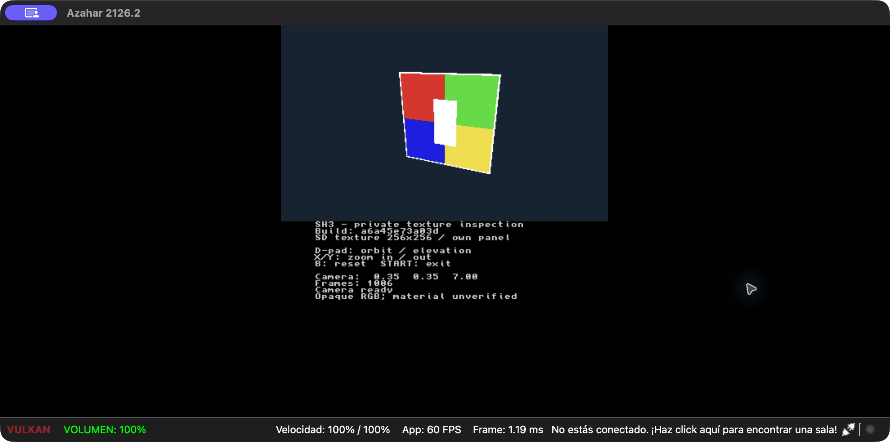

# F03.02 — Textura privada en el visor nativo

2026-10-20. Completadas TI-T1–TI-T5 de la
[spec EARS TI01–TI07](../specs/sh3-3ds/texture-inspection.md).
El ejecutable ARM lee una textura de SD y la muestra sobre un panel propio.
La muestra de [PX](f03-02-indexed-texture.md) se presentó en Azahar y el usuario
confirma su presentación, controles y ciclo de vida en New Nintendo 2DS XL.
La identificación del material y el contraste con su uso original siguen
pendientes; F03.02 global, G02/G03/G05 permanecen abiertos.

## Resultado y separación de responsabilidades

`sh3_texture_probe` es independiente de `sh3_render_probe` y `sh3_diagnostic`.
Lector stdio con dependencia sustituible, comprobación STX/CRC, conversión pura
RGBA→ABGR/Morton y panel de dominio separados. El renderer recibe píxeles
prestados y los copia durante su construcción; el temporal de 256 KiB se libera
antes del bucle. Reutiliza aplicación, cámara, lifecycle y puerto de presentación.
Textura, VBO y shader persisten durante los frames; no hay I/O por frame.

La paleta 0 se elige explícitamente para inspección. Se normaliza alpha como en
el PNG previo, pero el visor usa mezcla ONE/ZERO y muestra RGB opaco, con color
de vértice blanco. Esto no demuestra mezcla/alpha test, UV o paleta del material
original. No se incorporó geometría del juego, Heather ni simulación jugable.

El formato de 24 bytes de cabecera más 262144 bytes RGBA es STX1 propio y acotado;
no es un lector SH3P. Rechaza versión, dimensiones, formato, longitud, CRC,
archivo truncado o con trailer, errores de lectura y cierre.

## Validación y hallazgos

| Nivel | Resultado | Evidencia |
|---|---|---|
| macOS Release | 202/202; tras cambios, 42/42 de render y 2/2 de stdio repetidos | `host/final-results.xml`, `v4-results.xml`, `stdio-results.xml` |
| macOS ASan/UBSan | Mismos conjuntos, aprobados | `sanitize/` y logs de cada pase |
| Linux GCC | 202/202 sobre fuentes finales | `ci-source-v5/build/host-coverage/test-results.xml` |
| Cobertura C++ | 1054/1062 líneas (99,2 %), 971/1002 ramas (96,9 %) | `ci-source-v5/build/coverage-summary.json` |
| Módulo STX/transferencia | 55/55 líneas y 66/66 ramas | Mismo resumen |
| Python seleccionado | 217/217; 44 nuevos de empaquetado y 6 de script | `python-final.xml` |
| Cobertura de tres módulos Python | 164/166 líneas (98,80 %), 52/54 ramas (96,30 %) | `python-coverage.json` |
| ARM | Visor y demo sintética compilados con SDK fijado, hashes aprobados | `arm-coverage-v5.log` |
| Azahar 2126.2 ARM64/Vulkan | Orientación, RGB opaco, carga privada, órbita, zoom, B y START observados | Capturas sintéticas públicas y privadas separadas |
| New Nintendo 2DS XL | Usuario confirma textura, cruceta, controles de cámara, START, tapa y HOME tras corregir la ruta de SD; TI-T5 completada | [Registro físico](../compatibility/texture-inspection.md) |

Las rutas relativas de evidencia anteriores parten de `build/texture-inspection/`.
No se atribuyen estos resultados a toda la suite Python ni a CI remota.
CI incorpora el nuevo script y conserva únicamente código compilado, sin STX.
El build usa el digest devkitPro registrado en `toolchains/devkitpro-image.txt`.

Los tests cubren CRC IEEE conocido, cabecera byte a byte, truncamientos,
trailer, corrupción, fallos de lectura/cierre, buffers acotados y un oráculo
inverso de todos los texels Morton. El encoder Python alimenta al lector C++
real. Los dobles SDK comprueban 20 casos adicionales de adquisición,
presentación y liberación, y que los píxeles prestados no sobrevivan como
dependencia después de construir el renderer.

Hallazgos conservados:

1. El SDK ARM distingue `GPU_BLEND_ADD` de `GPU_ADD`. Se corrigió la llamada y
   se tipó también el doble de prueba. `arm-coverage-v2.log` conserva el rechazo.
2. El primer patrón apareció invertido verticalmente. Se eliminó el volteo de
   filas y se verificó rojo/verde arriba, azul/amarillo abajo; la mitad izquierda
   con alpha cero permanece visible, como exige la inspección opaca.
3. glibc declara `ferror` como `noexcept`; se ajustó el doble stdio. Los ensayos
   v3/v4 conservan el rechazo; v5 compila y pasa GCC sin relajar `-Werror`.



La captura anterior contiene solo datos propios. El build corregido v4 y la
entrega v5 tienen 3DSX idéntico byte a byte. Se observó `MISSING` sin archivo y
`VERIFY_FAILED` al modificar un byte del payload; START devolvió ambos a la
lista del emulador. Con la muestra privada, la cámara pasó de 0,35/0,35/7,00 a
−0,07/0,35/5,85, y B restauró los valores iniciales. START volvió a la lista.
Azahar se cerró después; no queda proceso de este ensayo.

El log conserva avisos de archivos de sistema/certificado ausentes en el perfil
aislado, homebrew sin title ID y `ConfigureNew3DSCPU` sin implementar. No se
declara un log libre de errores ni rendimiento físico a partir de sus 60 FPS.
HOME/tapa se verificaron posteriormente en consola por confirmación del usuario.
El error físico inicial `MISSING` se resolvió al colocar el paquete en
`/3ds/sh3_texture_probe/`, sin las carpetas `sd-card` adicionales. Se comprobó
el SHA-256 de los cuatro archivos copiados y el usuario confirmó el resultado.
La evidencia física no incluye medición de FPS/duración ni captura comparativa.

## Entrega privada identificada

Build **`a6a45e73a03d`**. Sesión `f03-02-3ds-texture-v2/` relativa a la raíz
privada autorizada. `sd-card.zip` contiene `3ds/sh3_texture_probe/` con 3DSX,
SMDH, `texture.stx`, instrucciones y hashes. El usuario puede extraerlo en la
raíz de su SD y abrir **SH3 texture inspection** desde Homebrew Launcher.
La entrega anterior v1 se conserva como ensayo; usar v2.

| Archivo | Bytes | SHA-256 |
|---|---:|---|
| `sd-card.zip` | 481357 | `0ed6e3237e5b88cee14bad04e05db0b25906c89d3088a4d499858e34cc90989b` |
| `sh3_texture_probe.3dsx` | 203292 | `0428f5c6b9d1ccc4582483c5d845b155c57f5a00f655dfaf4c06409a84997004` |
| `texture.stx` | 262168 | `9e102a4ca80eecaae97e33b4608c3099e87c55601db62a4658c90984472956c6` |

La preparación verifica el manifiesto PX
`9d7b684ca600b34ea8862c057c1b1e2f7d85e8f026dd4e6d6667a573eeb736d1`,
el RGBA seleccionado, su huella normalizada y los seis artefactos del build.
ZIP con nombres fijos, metadatos constantes y STORE; writer exclusivo 0700/0600
y manifiesto publicado al final. Los hashes interiores del ZIP se verificaron
antes de extraerlo en el perfil aislado.
La preparación desde la segunda copia decodificada produjo los mismos cinco
archivos de entrega, incluido el ZIP. Manifiesto privado SHA-256:
`ec0ea117beb3838452527a476f570a08de17e62dd827fafa647820dae2489581`.

La textura, ZIP, perfil y capturas con datos reales permanecen fuera del checkout.
Capturas privadas: `f03-02-inspection-emulator-v1/texture-real.png`,
`texture-controls.png`, `texture-reset.png`. El informe local de metadatos
`reports/local/f03-02-texture-inspection-v1.json` conserva hashes y resultados.
El manifiesto de fuentes está en `build/texture-inspection/source-manifest-v5.json`.
Sus 610 archivos coinciden con el checkout al cierre; SHA-256 del manifiesto:
`550e90157a812c726066ee2536ad235b918cdf114d742cc6ad13c894b76886ff`.
Ruff, clang-format, gate Python de líneas/ramas, arquitectura/custodia/enlaces
y `git diff --check` aprobados. No se creó commit.

## Repetición

Compilación, desde el SDK fijado y directorio nuevo:

```sh
bash scripts/build_texture_probe.sh
```

Preparación privada (la raíz es un marcador; elegir sesión nueva):

```sh
python -m tools.pipeline.prepare_texture_probe \
  --decoded /raiz/privada/f03-02-texture-a-v1 \
  --manifest-sha256 9d7b684ca600b34ea8862c057c1b1e2f7d85e8f026dd4e6d6667a573eeb736d1 \
  --palette 0 --build build/texture-probe \
  --private-root /raiz/privada --run-id nueva-entrega
```

TI-T5 cerrada por confirmación física del usuario. Siguiente trabajo: identificar
el material y comparar la muestra con su uso en PS2, antes de decidir la paleta
y su integración en una escena. Esta inspección no sustituye esa comparación.
