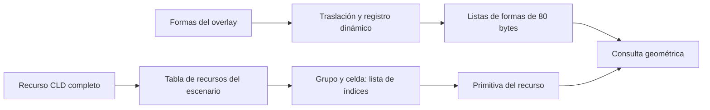

# F03.04 / CF-T1–T3 — Formas de colisión y listas del escenario

2026-10-23. **Investigación CF-T1–T3 completada para las fuentes fijadas.**
[Requisitos EARS, diseño y tareas CF](../specs/sh3-3ds/collision-shapes-research.md).
El resultado identifica estructura y enlaces; todavía no implementa un decoder
de producción, respuesta física ni un nuevo build 3DS. IR-T7 conserva su
[contrato de registros](../../schemas/collision-intermediate-v1.md).

## Resultado

Se distinguen dos rutas que no deben fusionarse por proximidad en memoria:



La ruta estática permite identificar **`tp1e.cld` en sala `0xEA`** y
**`tp1d.cld` en sala `0xEB`** por igualdad de todo el recurso entre RAM y las
extracciones A/B, además de comprobar sus punteros en las tablas. El nombre
de archivo es una etiqueta del catálogo, no el criterio de identificación.

La ruta dinámica confirma registros de **80 bytes**, cuatro vectores y un
terminador determinado por el byte inicial cero. Sus recorridos pueden
atravesar otros punteros registrados. La separación `0x2D0` entre destinos
**no define la longitud de cada lista**.

## Procedencia y alcance comprobado

- 30 estados y recibos: control 02; segmento continuo 08–35; diagnóstico 36
  tras restauración. Se conservan separados en el comprobante.
- 11 ventanas del ELF se cotejan byte por byte con RAM en cada estado;
  el texto del overlay, su tabla de doce enlaces y las doce secuencias fuente
  se cotejan también. El comprobante conserva direcciones, tamaños y hashes.
- 285 recursos de cada copia privada: **570 lecturas completas verificadas**,
  2.690.720 bytes por copia, igualdad A/B y sondeo estructural de todos.
- Después del análisis se verifican otra vez los 570 archivos y los 60 estados/
  recibos: **630 fuentes**, además de catálogo, inventario y tres informes
  anteriores. No se reescriben las evidencias ni las entregas IR-T7.

Se analizan las capturas conservadas; no se ejecuta PCSX2, no se carga un
estado y no se escribe en memoria del juego. La coincidencia estructural de
285 recursos no acredita sus 285 escenas en ejecución ni valida un solver.

## Ruta estática: recurso, registro y listas

| Capturas / sala | Recurso identificado | Tamaño | Dirección en RAM | SHA-256 completo |
|---|---|---:|---|---|
| 02 / `0xEA` | `tp1e.cld` | 19.552 | `0x0185FA00` | `1d5dee726af37e25e4e2687b0380a507abbf9473123c33f185b816b84523c751` |
| 08–35 y 36 / `0xEB` | `tp1d.cld` | 11.984 | `0x0163FA00` | `506c5140ede39d21541acc5568271f3da7dacc3f08a047db9e15bb79a3deb793` |

IDs del catálogo: `asset:f634b8f65108b0c2535233c48978f6313fa0a25d813d082b08eb53e464b3efa6`
y `asset:b0ed63c1c0be2c9410fd3444048c5ebe42e11894d58c0e74304c626f0e397728`,
respectivamente. Ambos pertenecen al mismo contenedor catalogado; el informe
histórico de candidatos permanece sin modificaciones.

El callback `0x0027B570` pasa su argumento de recurso a `0x001A7E00`, que
escribe `tabla[slot]` en `0x01D0A800`. El callback `0x0027B5A0` escribe cero
mediante la misma función. Se encuentran en una tabla de cinco entradas de
`0x38` bytes desde `0x00408B30`, con slots 0–4. En las capturas, la entrada 0
contiene el mismo puntero a recurso en `+0x30` y su tamaño completo en `+0x34`.
El prefijo de 16 bytes con callbacks/slot/tipo coincide con el ELF.

Esta tabla es **mutable**: durante la preparación del auditor, compararla
entera contra los ceros iniciales del ELF produjo un rechazo correcto. Se
separó la comprobación del prefijo estático de la del puntero/tamaño cargados.
Esto no sustituye una captura del callback ejecutándose: la transferencia
desde archivo y su secuencia de alta/baja aún no se han observado para CLD.

En los 30 estados, `0x01D0A7F0` vale 1, solo el slot 0 de la tabla de
recursos está ocupado y la lista auxiliar de consulta en `0x01D051A0`
contiene `(recurso, celda 0)` seguida de puntero cero. La selección se
construye por `0x001A5650` y sus ramas `0x001A56B0` / `0x001A5980`.
La segunda enumera recursos con celda cero; la primera examina una cuadrícula
de 4 × 4. No se atribuye al estado una llamada concreta a una de esas ramas.

### Estructura observada del recurso

Todos los offsets siguientes son relativos al principio del recurso,
little-endian; no son punteros host.

| Offset | Evidencia y lectura admitida |
|---|---|
| `0x00`, `0x04` | Dos f32 usados como origen X/Z por la ruta espacial. No fijan por sí mismos unidades del port. |
| `0x08`–`0x18` | Cinco tamaños en bytes, coherentes con los cinco grupos en los 285 recursos. Su coherencia es evidencia de datos; el consumidor de índices no depende de estos tamaños para cada acceso. |
| `0x1C` | La selección omite el recurso cuando esta palabra es distinta de cero; no se le asigna un nombre de gameplay. |
| `0x20`, `0x60`, `0xA0`, `0xE0`, `0x120` | Cinco tablas de 16 offsets u32, una por grupo. Cada offset lleva a una lista de índices u32 terminada en `0xFFFFFFFF`. |
| `0x160`–`0x170` | Cinco offsets u32 al principio de las formas de cada grupo. |
| Desde `0x174` | Región de listas de índices, acotada antes del primer grupo de formas. No se exige que todos los offsets sean distintos. |

El dispatcher `0x001A6200` combina el recurso con el offset de grupo y el de
la sublista elegida. Para los grupos 0–3, `0x001A4290` calcula
`base_formas + índice * 0x50`; incrementa la sublista en cuatro bytes y
termina en `0xFFFFFFFF`. Para el grupo 4, `0x001A6DD0` usa `índice * 0x30`.
La máscara de consulta selecciona grupos 0/1/2/3/4 mediante bits
`0x08`/`0x02`/`0x04`/`0x20`/`0x10`. No se renombran como categorías físicas
sin investigar sus demás consumidores.

En ambos recursos del carrusel, solamente la celda 0 contiene índices no
vacíos. Las cantidades de formas activas por grupo son:

| Recurso | Grupo 0 | Grupo 1 | Grupo 2 | Grupo 3 | Grupo 4 |
|---|---:|---:|---:|---:|---:|
| `tp1e.cld` | 10 | 0 | 105 | 105 | 0 |
| `tp1d.cld` | 1 | 0 | 49 | 80 | 0 |

Cada grupo incluye, además, un registro final completamente cero en este
corpus. Ese registro no es una forma activa ni un índice válido.

### Cabecera y variantes

| Offset de forma | Resultado |
|---|---|
| `+0x00`, u8 | Valor 1 en las formas activas observadas; cero termina la lista dinámica. No es un contador. |
| `+0x01`, u8 | En formas de 80 bytes: 0 dirige tres puntos a `0x0019F0E0`; distinto de cero dirige cuatro a `0x0019EEA0`. El corpus usa 0 y 1. |
| `+0x02`, u16 | Cero observado; significado pendiente. |
| `+0x04`, u32 | Constante 4 observada, también en las variantes de tres puntos y de 48 bytes. **No se interpreta como cantidad de vértices.** |
| `+0x08`, u32 | El consumidor aplica AND con la máscara de exclusión de la consulta; también pasa el valor a `0x001A7C80`. Semántica completa de bits pendiente; no es un material visual demostrado. |
| `+0x0C`, u32 | Cero observado; significado pendiente. |
| `+0x10`–`+0x40` | Cuatro vectores f32 de cuatro componentes en el registro de 80 bytes. La rama de tres puntos usa los tres primeros. |

El grupo 4 contiene formas de 48 bytes con variante 3 y llama a
`0x0019F2C0` con `forma+0x10`; la consulta produce tipo de resultado 2.
La consulta poligonal produce tipo 1. **No se congela todavía su interpretación
como esfera, cápsula o cilindro**, ni el significado de sus ocho f32.
Los dos recursos del carrusel no tienen formas activas de esa variante.

El sondeo de los 285 recursos encuentra **28.178 formas de 80 bytes**:
2.534 variantes de tres puntos y 25.644 de cuatro; más **293 formas de
48 bytes**. Todos los índices recorridos están dentro de su grupo y todos
los terminadores se encuentran dentro del archivo. Hay **cuatro registros
activos no referenciados por ninguna de sus 16 sublistas** —dos en grupo 1
y dos en grupo 3—; un decoder no debe exigir cobertura total ni eliminarlos.
No se inferirán winding, normal física o respuesta a partir de estos conteos.

## Ruta dinámica del overlay

La tabla de doce enlaces reside en `0x01EE9D30`. Para una fila con instancia
de actor, la fuente se calcula como `0x01EE3CD0 + índice * 80`; para las
otras filas, como `0x01EE5E90 + índice * 80`. Son fuentes del overlay,
independientes del CLD identificado arriba.

`0x001A0CD0` copia la cabecera y suma el vector recibido a los cuatro
vectores. Avanza fuente y destino `0x50` bytes mientras `fuente[0] != 0`.
**No escribe el terminador de la fuente en el destino.** Finalmente registra
el comienzo del destino mediante `0x001A0B70`.

`0x001A49D0` recorre los punteros del banco opuesto a `0x01D045E8`, examina
formas con paso 80 y termina por byte inicial cero. Después usa la misma
selección de tres/cuatro puntos y máscaras que la ruta indexada. Esto vincula
esas listas con la consulta, sin convertirlas en propietarios de impacto
de personaje ni acreditar daño a los actores `0x0209`.

| Índice de tabla | Asociación | Formas en la fuente | Recorrido banco 0 | Recorrido banco 1 |
|---:|---|---:|---:|---:|
| 0 | Objeto de mapa 4 | 13 | 26 | 17 |
| 1 | Actor `0x018F` | 5 | 8 | 8 |
| 2 | Actor `0x0190` | 1 | 8 | 8 |
| 3 | Objeto de mapa 11 | 13 | 162 | 153 |
| 4 | Objeto de mapa 6 | 13 | 144 | 135 |
| 5 | Objeto de mapa 5 | 13 | 126 | 117 |
| 6 | Objeto de mapa 10 | 13 | 108 | 99 |
| 7 | Objeto de mapa 8 | 13 | 90 | 81 |
| 8 | Objeto de mapa 9 | 13 | 72 | 63 |
| 9 | Objeto de mapa 7 | 13 | 54 | 45 |
| 10 | Objeto de mapa 12 | 13 | 36 | 27 |
| 11 | Actor `0x018E` | 9 | 18 | 9 |

Los conteos de destino son iguales en las 29 capturas de sala `0xEB`; se
obtienen caminando hasta el terminador real, sin truncar a nueve registros.
En el control 02, ambos bancos apuntan a `0x01EEB6B0` y recorren ocho formas.

La fórmula de destino es `0x01EEA030 + fila*0x5A0 + banco*0x2D0`.
`0x2D0` equivale a nueve registros, pero nueve fuentes contienen trece:
su copia cruza el comienzo del otro destino. Sumado a la ausencia de copia
del terminador, esto explica por qué no basta el conteo fuente para describir
el recorrido posterior. **No se atribuye aquí un fallo jugable al original**:
se conserva el comportamiento observado y queda pendiente caracterizar su
ciclo completo de inicialización y sobrescritura.

### Transformación contrastada

La rama de actores actualiza `actor+0x24` y pasa el mismo desplazamiento Y a
la transformación. Se usa esa posición como referencia independiente y las
formas originales del overlay como entrada. El destino más reciente se
selecciona como `1 - [0x01EEA020]`, de acuerdo con la alternancia posterior
a las doce llamadas. En estas capturas coincide con `0x01D045E8`; el consumidor
analizado lee el banco opuesto. **Banco más reciente y banco consultado no
son sinónimos.**

Se contrastan 5 + 1 + 9 formas, cuatro vectores cada una, en 28 muestras
continuas y un diagnóstico separado: **1.740 vértices**. Las cabeceras y
componentes X/Z/W coinciden; Y se compara con `f32(origen.y + actor.y)`.
Error absoluto máximo **0,000244140625**, menor que el umbral de **0,001**
unidades de origen usado para esta comprobación. 758 sumas no son idénticas
al redondeo f32 host; no se declara equivalencia numérica exacta con VU0.

Este contraste cubre las porciones recién escritas de las tres listas
asociadas a actores. No cubre como transformaciones independientes las nueve
colocaciones de objetos, las colas residuales ni el banco anterior, que puede
haber sido parcialmente sobrescrito por la copia de una lista vecina.

## Reproducción y controles

Comprobante local, solo metadatos:
`reports/local/f03-04-collision-shapes-research-v1.json`, **1.694.054 bytes**,
SHA-256 `80315f08d6d055d048c84a20dfd483f5be806d94bf9a67d4efe4ffeb16cfe11a`.
Auditor local `build/collision-shapes/audit_shapes.py`, SHA-256
`457b9b1289945448589f0dd5d4ba8e57ea03df89a40832e18420043718c45d3c`.

```sh
rtk proxy .venv/bin/python build/collision-shapes/audit_shapes.py
```

Sin argumentos de salida, verifica y muestra tamaño/hash sin escribir. Con
`--output reports/local/<nombre-nuevo>.json` crea un archivo exclusivo 0600;
no reemplaza informes existentes. Requiere ISO privada, extracciones, capturas,
inventario y auxiliares locales. Se rechaza `-O` porque los lectores históricos
usan aserciones; no se presenta como lector endurecido para entradas ajenas.

Se rechazan **13 controles negativos** en buffers locales: truncamiento,
stride inválido, offset/índice fuera de rango, falta de terminador de índices
o formas, NaN, variante no observada, falsa extensión de nueve registros,
registro de recurso incorrecto, corrupción del recurso cargado, selección
auxiliar incongruente y vértice dinámico alterado. Ninguno modifica los originales.

La repetición sin salida produce exactamente el mismo tamaño/SHA-256 del
comprobante. Se verifican permisos 0600, hashes de los auxiliares y rechazo
de ejecución con `-O`. Controles de repositorio: **PASS, 0 errores**;
575 enlaces locales de los documentos afectados sin roturas y
`git diff --check` aprobado. No cambió código de producción ni se repitieron
compilaciones ARM o la batería global anterior como si fueran evidencia nueva.

## Pendientes y siguiente tarea

**[CF-T4 completada](f03-04-collision-polygons-contract.md):** contrato del
primer decoder puro para el subconjunto
poligonal demostrado, con conservación de campos opacos, listas vacías,
índices repetidos/compartidos, registros no referenciados, terminadores y
límites explícitos. Debe separar recursos indexados de listas dinámicas
observadas y no reconstruir estas últimas usando la separación de punteros.
Dos fixtures y 50 vectores propios preparados y auditados. Después, CF-T5:
decoder, oráculo público independiente, batería completa de límites y
cobertura por módulo antes de integración privada A/B.

Quedan abiertos: captura del alta/baja del CLD desde el cargador, semántica de
la variante de 48 bytes, todos los bits de filtro, orientación y reglas de
contacto, ciclo de sobrescritura de listas dinámicas, paso a coordenadas del
port y respuesta física. No cambian daño/muerte, capacidades de IR-T7,
F03.04 global ni los gates G02/G03.
