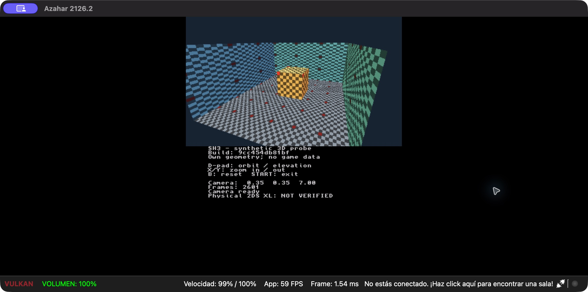

# F05.01 — Primer corte gráfico 3D sintético

Fecha: 2026-10-20. Instancia preparatoria de F05.01, con
[requisitos EARS y tareas](../specs/sh3-3ds/synthetic-render.md).

## Resultado y alcance

Se implementó un ejecutable 3DS independiente que presenta suelo, tres paredes y
un cubo texturizado con cámara orbital, perspectiva y profundidad. Sus datos son
propios y procedurales. El diagnóstico anterior sigue disponible. No se han
portado reglas de juego, personaje, recursos ni una sala original de SH3.
G01, G03, F05.01 completo y G05 permanecen abiertos.



## Arquitectura y errores

- Dominio: malla fija y valores de cámara sin SDK.
- Aplicación: actualización acotada, rechazo de entrada no finita, suspensión,
  liberación de controles al volver y prioridad de salida.
- Puerto: `IRenderScene` devuelve presentación, ocupado, cámara inválida o error.
- Adaptador: shader PICA200, VBO de 1.920 bytes, textura RGBA8 de 16.384 bytes,
  target con profundidad, filtros nearest/repeat y material opaco.
- Propiedad: RAII libera target/sincroniza GPU antes de textura, VBO y programa;
  Citro3D termina antes de gfx. Fallos parciales liberan solo lo adquirido.

No se introdujo una interfaz por vértice ni una abstracción de motor completa.
El programa reutiliza sus recursos durante los frames. La cubierta host compila
el adaptador real contra dobles separados; no ejecuta shaders ni acredita GPU física.

## Verificación

La evidencia local está en `build/f05-01/`, ignorada por Git.

| Nivel | Resultado | Evidencia local |
|---|---|---|
| CTest macOS Release | 180/180, incluidos 20 casos nuevos del corte gráfico | `final-release.xml` |
| CTest macOS ASan/UBSan | 180/180, sin hallazgos | `final-sanitize.xml` |
| Regresiones tras aclarar los cuatro tests anteriores | 40/40 en Release y 40/40 con sanitizadores | `flow-fixes-*.xml` |
| CTest Linux GCC 12.2 y cobertura atómica | 180/180 | `atomic-tests.xml` |
| Cobertura C++ portable, incluido observador | 991/1000 líneas (99,1 %), 903/936 ramas (96,5 %) | `atomic-summary.json`, `atomic-coverage.xml` |
| Nuevos módulos portables | Escena/textura 100 % líneas y ramas; controlador 100 % líneas y 92,5 % ramas | `atomic-summary.json` |
| Python de build, SDK y repositorio | 114/114, seis nuevos del script gráfico | `final-python.xml` |
| Arquitectura, custodia y referencias | PASS, cero errores | `tools.qa.check_repository` |
| Build ARM, SDK fijado | Ambos scripts pasan; 3DSX gráfico idéntico entre directorios | `ci-source/diagnostic-build.log`, `ci-source/render-build.log` |
| Azahar | Imagen, controles y salida observados; arranque/START repetidos sobre entrega | Captura pública y `final-*.png` |
| New Nintendo 2DS XL | Arranque, cruceta, X/Y, B y START confirmados por el usuario; recorrido físico parcial | [Registro del 2026-10-20](../compatibility/synthetic-render-probe.md#registro--2026-10-20) |
| CI remota | Pendiente | No se atribuye ejecución de GitHub Actions |

Las suites añadidas cubren geometría no degenerada, rango/finitez de cámara,
sincronización con suspensión, entradas extremas, prioridad START, 4.096 offsets
de textura y sus bytes, fallos de adquisición, frame ocupado, rechazo del target
y ausencia de nuevas reservas SDK en 1.000 presentaciones.

La prueba gráfica usó Azahar 2126.2 ARM64, Vulkan/MoltenVK en Apple M2, con una
copia y perfil portables nuevos bajo `build/f05-01/emulator`. Se observó la
textura, perspectiva y oclusión; se ejercitaron giro, elevación, zoom, B y START.
La barra del emulador mostró 60 FPS, que no se utiliza como medida de rendimiento
de la consola. El recorrido de suspensión y retorno mediante HOME/tapa sigue
pendiente de confirmación detallada en hardware.

Después de recibir el paquete, el usuario confirmó que funciona en su 2DS XL,
que la cruceta mueve la cámara y que funcionan todos los botones consultados
(X/Y, B y START). Es evidencia física comunicada por el usuario. La duración,
el cotejo del ID, la inspección de textura/oclusión y los ciclos de suspensión
quedan pendientes en el registro; SR-T5 aún no se cierra.

Los logs de Azahar contienen avisos de archivos de sistema ausentes en el perfil
nuevo, título homebrew sin ID y `ConfigureNew3DSCPU` no implementado; también un
fallo de su comprobador de actualizaciones y avisos de MoltenVK. No se declara
un log libre de errores. Se observaron frames y retorno a la lista tras START;
el proceso del primer ensayo terminó con código 0.

## Hallazgos corregidos

1. El primer límite orbital (±0,9 rad) permitía ver la pared lateral desde fuera,
   ocultando el cubo. Se redujo a ±0,55, se añadió un oráculo de intersección con
   el frente abierto y se repitió la prueba visual. Se conserva el primer build
   y la captura en `arm-1/` y `arm-1-yaw-limit.png`.
2. GCC rechazó once controles de flujo ambiguos por formato en cuatro pruebas
   anteriores del observador. Se añadieron llaves/separación de sentencias sin
   modificar sus condiciones ni desactivar `-Werror`. Logs de rechazo conservados.
3. La cobertura inicial produjo contadores negativos durante tests concurrentes.
   Se añadió `-fprofile-update=atomic` al modo GCC de cobertura y se repitió desde
   una carpeta limpia: 99,1 %/96,5 %, sin ignorar errores del parser ni bajar umbrales.

## Build y continuidad

El SDK sigue fijado por `toolchains/devkitpro-image.txt`. `build_render_probe.sh`
rechaza cualquier destino existente y comprueba sus seis archivos antes de
generar/verificar hashes. CI conserva ELF, 3DSX, SMDH, ID, SDK y paquetes;
no se ha ejecutado GitHub Actions remotamente en esta instancia.

**Entrega:** build `9cc454db81bf`; 3DSX de 173.884 bytes, SHA-256
`88b988c358ab1bae509e3d7c0ae22f49e82f8755f6221fa171d884fb768f0069`.
ELF SHA-256 `2c6c323f6e8d49c249766d3161887bb837069bb12eb9a80d747a08ff8a0639f3`.
Fuentes ARM y CMake de la copia limpia contrastados byte a byte con el checkout.
El build anterior `c369a6f649b5` se usó para el recorrido de cámara; el cambio
posterior de CMake afecta solo a cobertura host. Se repitieron arranque, imagen,
identidad y START con el 3DSX de entrega.

Artefactos: `build/f05-01/ci-source/build/render-probe/`. Copia lista para SD:
`build/f05-01/sd-card/3ds/sh3_render_probe/`; paquete
`build/f05-01/sh3-render-probe-9cc454db81bf.zip`.

Comandos de reproducción, en directorios nuevos y dentro del SDK fijado:

```sh
bash scripts/build_3ds.sh
bash scripts/build_render_probe.sh
cmake -S . -B build/host-coverage -DSH3_COVERAGE=ON -DCMAKE_BUILD_TYPE=Debug
cmake --build build/host-coverage --parallel 3
ctest --test-dir build/host-coverage --output-on-failure --no-tests=error
gcovr --config gcovr.cfg
```

En macOS se usaron AppleClang 21 para Release y LLVM Clang 22.1.4 para
ASan/UBSan. El build 3DS usa GCC 16.1.0. Los 114 casos Python se limitan a
`test_render_build_script.py`, `test_build_artifacts.py`, `test_repository.py`
y `test_toolchain_script.py`; no se declara repetida la batería Python completa.

Próximo paso dependiente de consola: completar el recorrido pendiente de
[SR-T5, guía física](../compatibility/synthetic-render-probe.md).
En paralelo puede abordarse una primera textura real identificada mediante F03,
con contrato y comparación de su decodificación antes de integrarla en esta escena.
La investigación pendiente F02.07 se conserva, pero no bloquea este corte sintético.
