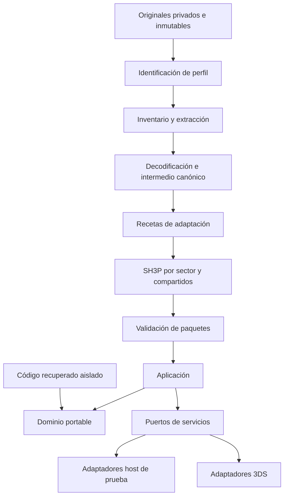

# Diseño técnico propuesto

Versión 1.0 · 2026-10-16 · Derivado del PDF, pp. 3-6 y 9-28.

Este diseño desarrolla [requirements.md](requirements.md). Las interfaces de producto descritas siguen como propuestas; el diagnóstico inicial implementa contratos más pequeños, descritos en el informe de ejecución, sin declarar los servicios completos del juego. La adopción de terceros se verifica por herramienta en F01; el subconjunto ya fijado y compilado figura en el [inventario](../../compatibility/toolchain.md).

## Arquitectura

El pipeline transforma datos de una edición PS2 identificada fuera de la consola. El runtime consume paquetes validados y ejecuta comportamiento portable con servicios nativos. La alternativa de emular PS2 en 3DS no forma parte del diseño. Recuperar un binario coincidente de PS2 no demuestra que su lógica sea portable: F04 proporciona esa evidencia por subsistema.

La investigación de comportamiento usa observaciones privadas del original, ligadas a edición, módulo, entradas y estado inicial. No se presupone que direcciones PS2, overlays, punteros o microprogramas tengan equivalentes ejecutables en ARM. El catálogo de F04 clasifica C reutilizable, C que requiere adaptación, ensamblador y dependencias VU/GS/IOP. La simulación adopta la semántica temporal demostrada, separada de los 30 FPS propuestos para presentación.

## Componentes y responsabilidades

Los IDs C01-C13 se usan en la matriz de [validation.md](validation.md).

| ID | Componente y rutas futuras | Responsabilidad | Requisitos principales |
|---|---|---|---|
| C01 | `tools/inspectors/`, `content-manifests/` | Identificar edición, registrar origen y catalogar cobertura sin interpretar datos desconocidos como soportados | RF01, RF02, RNF08, RNF12 |
| C02 | `tools/pipeline/`, `recipes/`, `schemas/` | Extraer, decodificar, conservar intermedio y producir paquetes deterministas | RF02, RF03, RF08, RF09, RNF05, RNF06 |
| C03 | `engine/application/`, `engine/ports/` | Orquestar tick, carga, pausa, secuencias y guardado; composición explícita | RF05, RF12, RNF04, RNF11 |
| C04 | `engine/domain/`, `engine/recovered/` | Movimiento, estado, combate, inventario, progreso y lógica recuperada con procedencia | RF04-RF07, RF13, RNF04, RNF09 |
| C05 | `engine/platform/3ds/render/` | Buffers, materiales, transformaciones, animación visible, PICA200 y presentación | RF03, RF04, RNF01, RNF02 |
| C06 | `engine/application/streaming/` | Dependencias, residencia, carga por sector y liberación diferida | RF01, RF05, RNF02, RNF03, RNF06 |
| C07 | `engine/platform/3ds/audio/` | Inicialización NDSP, colas, prioridades, loops y recuperación | RF08, RF12, RNF01, RNF02 |
| C08 | `engine/application/narrative/` | Timeline, proveedor de video, subtítulos y estado al terminar o saltar | RF09, RF12, RNF09 |
| C09 | `engine/application/save/`, adaptadores de almacenamiento | Validación de generaciones, recuperación y migraciones explícitas | RF10, RNF06, RNF12 |
| C10 | `engine/platform/3ds/input/`, `engine/platform/3ds/ui/` | Mapeo, menú, inventario visible, mensajes y accesos complementarios táctiles | RF11, RF12 |
| C11 | `engine/ports/`, `docs/benchmarks/`, `reports/` | Relojes, métricas, errores tipados, logs acotados y evidencia | RF14, RNF01-RNF03, RNF07 |
| C12 | `engine/platform/host/`, `tests/` | Dobles controlados, pruebas diferenciales, fallos de I/O y regresiones sintéticas | Todos los grupos; RNF04, RNF07, RNF09 |
| C13 | `docs/compatibility/`, `docs/adr/`, empaquetado futuro | Alcance, licencias, perfil soportado, checksums y publicación revisada | RF13, RF14, RNF05, RNF08, RNF12 |

La ejecución inicial creó dominio, aplicación, puertos diagnósticos y adaptadores host/3DS. El resto sigue propuesto. El estado exacto se documenta en [fundación](../../execution/foundation.md) y las reglas SOLID en [ingeniería](../../engineering.md).

### Composición y pruebas del diagnóstico F01.02

`main.cpp` delega en `platform/3ds/diagnostic.cpp`. Gráficos RAII, entrada, vista y hook conservan responsabilidades separadas y referencias por constructor. El target se elimina esperando la cola GPU antes de finalizar Citro2D; el hook se retira antes de destruir aplicación/audio. Las tres etapas gráficas recuperables informan error y no construyen consumidores si no hay pantalla.

Un target CMake host compila esa misma composición contra dobles SDK/Tone propios, con diez escenarios de entrada, error y liberación. Los tres puertos de aplicación no cambian. Los dobles solo pertenecen a pruebas; el build ARM usa cabeceras/bibliotecas reales y `tone.cpp`. Los [resultados F01.02](../../execution/f01-02-diagnostic.md) distinguen contratos, compilación y ejecución física pendiente. No se presenta esta prueba como un renderer de juego completo.

### Archivos y opciones del diagnóstico F01.03

El [contrato propio v1](../../../schemas/diagnostic-options-v1.md) mantiene un fixture de lectura y dos slots de opciones, separados de partidas. El codec puro valida 16 bytes y la aplicación selecciona generaciones, bloquea lecturas inciertas y confirma memoria después de escribir/cerrar/releer el slot alterno. No se depende de rename ni se presume durabilidad de la SD.

`IFileReader` y `IFileWriter` exponen IDs de archivo y errores tipados; `StdioFiles` implementa I/O acotada y cierre de handles sobre stdio. La fachada `file_probe.cpp` verifica el fixture y prepara estados para la vista; X cambia el tono, Y restaura el predeterminado. Los errores incluyen etapa y build visibles. El tono recibe su estado inicial antes de encolar PCM. Los dobles stdio/SDK son exclusivos de pruebas; el mismo adaptador de archivos se compila para host y ARM.

### Tono y servicio NDSP del diagnóstico F01.04

[Contrato local C01-C08](../../compatibility/audio-contract.md): Tone posee exclusivamente NDSP/canal 0, un bloque PCM de 44100 bytes y el descriptor en bucle. Clasifica init, reserva y flush fallidos; conserva Result real solo cuando aplica y libera inmediatamente lo adquirido. Un snapshot expone preparación, etapa, pausa solicitada y contadores SDK brutos; la vista incluye build/escena y escucha NOT_VERIFIED.

Se mantiene mute inicial antes de encolar, se evitan pausas redundantes y el cierre sigue clear → ndspExit → linearFree. El PCM y descriptor sobreviven al cierre del servicio. Tone no es copiable ni compartido; no se introduce un mezclador ni una dependencia SDK en el núcleo. Cinco casos host compilan el adaptador real con llamadas NDSP controladas, separados de los diecinueve casos de composición. El [procedimiento físico](../../compatibility/audio-probe.md) requiere consola y conserva los contadores como observación, sin equipararlos con audio audible.

### Ciclo de vida F01.07

La aplicación omite entrada/vista mientras suspended; la reanudación llega por dispatch en el mismo hilo. Input considera down/held y exige liberación completa tras retorno o combinación ajena. LifecycleHook aplica efectos solo a cambios reales y no revive una sesión stopped; el bucle ajusta el tono después de APT. [Contrato/política](../../compatibility/lifecycle-contract.md) y [evidencia](../../execution/f01-07-lifecycle.md). El modelo conserva cuatro estados, sin una jerarquía de servicios anticipada. Los botones de sistema siguen en APT.

### Recursos y tiempos F01.06

`ResourceProbe` devuelve valores/estados y Result de consultas SDK; `TimingWindow` limita retención y calcula p95 en platform/common. La vista instrumenta fronteras FrameBegin/dibujo-envío/lectura audio, renueva recursos cada 60 intentos y alterna página con SELECT. Los hooks reinician epoch sin mezclar tapa o pausa con tiempos activos. [Contrato/protocolo](../../compatibility/resource-contract.md) y [evidencia](../../execution/f01-06-resources.md). B_app, reloj CPU y versión de launcher no se infieren de pools nominales, porcentaje APT o flag HB. El dominio sigue libre de tipos SDK.

### Evidencia de depuración F01.05

[Contrato D01-D06](../../compatibility/debugging-contract.md): la herramienta host vincula ELF/3DSX con ID y SHA-256 después del build; la verificación usa el manifiesto conservado y el ID esperado. CMake/script/CI componen generación y retención, separados del runtime. GDB del SDK resuelve DWARF y controla la sesión; no se agrega un cliente ni lógica de depuración al dominio. El [informe](../../execution/f01-05-debugging.md) distingue breakpoint alcanzado en Azahar, anomalía de refresco abierta y consola no ejecutada.

### Automatización F01.08

[Contrato B01-B07](../../compatibility/build-contract.md): scripts orquestan procesos; `tools.debug.bundle` conserva la verificación ELF/3DSX; `tools.qa.build_artifacts` comprueba el conjunto completo y su CLI emite un recibo exclusivo. La inyección de herramientas por PATH pertenece solo a tests. Los presets rechazan cero pruebas y la CI conserva logs/reportes con propagación de errores. El [protocolo físico](../../compatibility/diagnostic-soak.md) identifica sesión, checkpoints y resultados sin introducir certificación automática en el núcleo. [Evidencia local](../../execution/f01-08-builds.md).

### Inventario ISO F02.01

[Contrato I01-I08](../../../schemas/source-inventory-v1.md): `signatures` clasifica prefijos acotados sin I/O; `inventory` coordina verificación completa, IDs y dependencias por el puerto `InventoryReader`; `IsoImage` añade ubicación de extents contiguos al lector existente; `catalog` compone lectura y JSON exclusivo. Clasificación, hashing y almacenamiento conservan responsabilidades separadas. Los IDs dependen de imagen/perfil/ruta, y el documento no incluye fecha ni rutas locales. El [resultado europeo](../../execution/f02-01-inventory.md) enumera 113 archivos ISO; MFA y contenido interno permanecen desconocidos o pendientes. Ninguna firma candidata concede capacidades de extracción/decodificación/runtime.

### Sondeo MFA F02.02

[Contrato M01-M08](../../../schemas/mfa-probe-v1.md): `mfa` valida el layout D8 por `RangeReader`; `MemberRange` delega en `IsoImage.read_range` y `mfa_probe` compone el inventario ya verificado. La lectura de rangos es exacta y confinada a un miembro; formato y almacenamiento permanecen separados. Un `MfaError` produce desconocido por archivo, mientras I/O/identidad abortan toda la operación. Se escriben metadatos tras cierre estable, sin exportación de recursos. [Resultado](../../execution/f02-02-mfa-candidate.md): dos candidatos estructurales (47 entradas), 60 desconocidos. No se adopta código del candidato Windows, no se valida payload ni se otorgan capacidades de extracción. B8 y nombres XBG0 continúan en F02.03.

### Variantes y diagnóstico de nombres F02.03

[MV01-MV08](../../../schemas/mfa-probe-v2.md): `inspect_layout` recibe B8/D8 explícito y comparte la validación de bloques; rechaza cabeceras iniciales ambiguas y no intenta otro layout ante fallo. `inspect_d8` conserva su interfaz. `mfa_names` describe candidatos de codificación con un límite de 1024 bytes y no decide aceptación; los nombres siguen sujetos a política ASCII. Los errores de entrada contienen contexto numérico y estadísticas sin cadenas crudas. La CLI emite esquema/herramienta v2 con selección fija; informes históricos intactos. [Evidencia](../../execution/f02-03-container-variants.md): 61 contenedores/1740 entradas estructurales entre ambos layouts; XBG0 conserva codificación no resuelta. No cambia el lector ISO ni el runtime.

### Catálogo interno F02.04

[A01-A11](../../../schemas/asset-catalog-v1.md): `asset_selection` valida una matriz explícita ligada a imagen/perfil/archivos y calcula su digest canónico. `mfa.parse_layout` entrega descriptores solo después de validar la cadena completa; los sondeos consumen el mismo resumen. `asset_catalog` coordina IDs por origen/posición, offsets y hashes mediante `AssetReader`; `IsoImage.hash_range` abre el miembro una vez por recurso y reutiliza hashing con EOF lógico y bloques de hasta 1 MiB. La CLI persiste JSON exclusivo tras el cierre estable. No usa nombres internos como rutas de salida. Error estructural conserva desconocido; error de identidad/transporte/presupuesto aborta. [Evidencia](../../execution/f02-04-asset-catalog.md): dos catálogos idénticos, 61 MFA/1740 recursos, 582 pruebas; tipos y dependencias semánticas pendientes, sin extracción ni capacidades de runtime.

### Extracción repetible F02.05

[X01-X11](../../../schemas/extraction-v1.md): `transfer` copia streams acotados; `IsoImage.copy_range` confina lectura al miembro; `PrivateOutput` posee descriptores POSIX, crea exclusivamente por ID y verifica salidas. `extract_assets` coordina sobre `CopyReader`/`OutputStore`: regenera y compara catálogo antes de cada copia, exige cierre estable de origen y relee ambos conjuntos antes del recibo final. JSON se publica con hard link exclusivo después de escritura/sincronización; parciales se conservan sin aceptación. [Evidencia](../../execution/f02-05-repeatable-extraction.md): 1740 recursos en cada copia externa, hashes iguales al catálogo, 686 pruebas. El perfil canónico no se modifica; el recibo identifica por separado extractor v1. XBG0/AFS, tipos, dependencias y corpus siguen pendientes.

### Robustez de extracción F02.06

[H01-H07](../../../schemas/extraction-hardening-v1.md): el adaptador conserva propiedad del descriptor hasta que el stream lo acepta; el recorrido transfiere propiedad antes de cerrar el descriptor anterior y la limpieza intenta todos los cierres sin ocultar el error principal. La CLI distingue confirmación publicada de limpieza posterior y emite advertencia de cierre sin inventar un rechazo. Parser, rangos, hashes y bytes transferidos permanecen idénticos. Las interrupciones sincronizadas existen solo en el helper de pruebas. [Evidencia](../../execution/f02-06-extraction-hardening.md): 80 mutaciones, fronteras, matriz de I/O y cuatro SIGKILL sintéticos; 828 pruebas totales. No amplía soporte de formatos ni modifica el runtime.

## Puertos y contratos de interacción

Nombres tomados del PDF, p. 9. Las operaciones de la tabla son pseudocontratos propuestos; las firmas C++ y el modelo de concurrencia se fijan con fixtures y mediciones. El límite de abstracción es el subsistema: se permiten lotes y datos contiguos en rutas intensivas, sin llamadas virtuales por vértice o muestra.

| Puerto | Entrada y salida lógica | Propiedad, errores y doble host |
|---|---|---|
| `IRenderer` | Frame, cámara y lotes de geometría/materiales → envío y estado de finalización | El recurso permanece vivo hasta completar su uso GPU; fallo tipado de creación/envío; host registra comandos para comprobar orden |
| `IAudioDevice` | Descripción de stream y buffers → estados consumido/pendiente y contadores | Los buffers en cola no se reutilizan antes de consumirse; errores de inicialización y underrun; host simula consumo y suspensión |
| `IInputSource` | Muestreo de controles → snapshot de acciones según mapeo | Snapshot estable por tick; permite reproducir entradas grabadas; evita dependencias de botones en reglas de dominio |
| `IAssetStore` | Perfil, sector/ID y versión → recurso validado o error | Precondiciones de compatibilidad y límites; dependencias y residencia explícitas; host permite truncamiento y lectura parcial |
| `ISaveStore` | Slot/generación y bytes serializados → resultado de lectura, escritura y verificación | No promete atomicidad por renombrado; permite interrupción en cada paso y conserva generación previa |
| `IClock` | Dominio temporal → tiempo/tick observado | Relojes de simulación, presentación y audio identificados; host controla avance, pausa y retrasos |
| `ILogger` | Evento tipado, build, escena y contexto mínimo → registro acotado | Capacidad y rotación configuradas; no conserva originales ni dumps completos por defecto |

Los errores propuestos son categorías del proyecto: `ProfileMismatch`, `UnsupportedSchema`, `InvalidRange`, `MissingDependency`, `OutOfMemory`, `IoFailure`, `NoValidSave` y `AudioUnavailable`. Sus códigos estables y mensajes se concretan en F01/F03, no se presentan como valores existentes de libctru.

## Modelos de datos

Todos los campos siguientes son contratos lógicos. No son una descripción de MFA ni offsets observados de Silent Hill 3. No se asignan hashes, anchuras binarias, límites ni direcciones desconocidas.

### Perfil y trazabilidad

`GameProfile` contiene ID, plataforma, región, revisión, serial, idioma, capacidades, archivos requeridos con tamaño y SHA-256, versión de extractor y versión de esquema propia. La copia europea observada tiene el perfil `ps2-sles-51434-9a94b95e777dae42`, capacidades vacías, revisión `1.02` e idiomas `en,fr,de,es,it`, asignados tras coincidencia completa con la referencia Redump 1064. `catalog.py` compara datos externos fijados; `hashing.py` calcula huellas locales; `IsoImage` controla I/O y estabilidad. El informe distingue evidencia de catálogo de pruebas de ejecución. `system_cnf_ver=1.02` se registra aparte. El candidato `ps2-ntsc-u-1.02` del PDF no se activa ni comparte offsets. Hashes externos y hashes locales se almacenan en campos separados.

F00.05 concreta el [contrato v1](../../../schemas/game-profile-v1.md) y el [inventario de fuentes](../../compatibility/sources.md). `tools/qa/custody.py` contiene decisiones por metadatos y el adaptador de inspección Git/filesystem; `check_repository.py` compone esa comprobación con arquitectura y trazabilidad. La custodia no modifica el perfil ni interpreta recursos del juego.

`AssetRecord` contiene ID estable, ubicación privada de origen, contenedor/offset cuando proceda, hash de entrada, tipo, decodificador, dependencias, estado de soporte y receta. Estados propuestos: `unknown`, `identified`, `decoded`, `converted`, `validated`, `blocked`. Solo `validated` con evidencia aporta cobertura. Tipos mínimos: malla, textura, esqueleto, animación, colisión, cámara, evento, texto, audio y secuencia.

`ConversionRecipe` registra versión, herramientas fijadas, parámetros, dimensiones/complejidad inicial y final y pérdidas aceptadas. Las salidas de inspección glTF/PNG/WAV/JSON son opcionales; los metadatos no representables permanecen en archivos auxiliares. La representación intermedia se conserva para reconvertir sin repetir la investigación.

### Intermedio geométrico y de animación

Malla: unidades, ejes, winding, atributos, índices, UV y materiales. Esqueleto: IDs, jerarquía y pose de referencia. Animación: clips, base temporal, interpolación, transformaciones y eventos, con una única autoridad para el movimiento raíz. Colisión y activadores tienen representaciones independientes de la simplificación visual. Cámaras y eventos conservan metadatos propios sin presumir un lenguaje de scripts del original.

Se rechazan valores no finitos, índices inválidos, jerarquías no válidas y referencias ausentes. Fixtures sintéticos asimétricos revelan inversiones de eje o caras antes de inspeccionar recursos privados.

### SH3P propuesto

Cabecera: identificador de formato, esquema, motor mínimo, perfil, tablas de entradas/dependencias e integridad. Entrada: tipo, ID, offset relativo, tamaño almacenado, tamaño descomprimido, método de compresión y hash. Endianess little-endian explícito. La especificación binaria exacta y el algoritmo de integridad se cierran en F03 antes del lector; Q07 impide tratar este esquema lógico como formato congelado.

Orden de validación: cabecera y versión → rangos y aritmética sin desbordamiento → tablas y unicidad → integridad y dependencias → límites por recurso y descompresión → reserva acotada → exposición al motor. Un fallo en cualquier paso impide consumir esa entrada. Los paquetes compartidos incluyen dependencias calculadas; un ID residente no produce copias descontroladas.

### Guardado propio

`SaveGeneration` contiene versión, perfil, número de secuencia, integridad, escena, posición, inventario, flags, entidades persistentes, dificultad y relojes necesarios. Dos generaciones alternas permiten mantener una copia íntegra mientras se produce otra. Una propuesta de secuencia operativa es:

1. Capturar un snapshot lógico consistente del progreso confirmado.
2. Elegir la generación destino que no sea la única válida.
3. Escribir la nueva generación y completar las operaciones de almacenamiento disponibles.
4. Volver a leer y validar integridad y estado completo.
5. Considerar elegible la nueva secuencia solo si supera validación; retener la anterior.

Al arrancar se validan ambas y se elige la completa más reciente. La señal de completitud, tratamiento de empates/desbordamiento y garantías reales de escritura se documentan en F07. No se presume durabilidad ante pérdida de energía por un simple `rename`. Las interrupciones se inyectan en host y en consola con copias desechables. No se pide retirar una SD durante una escritura real ni se importan guardados PS2/PC automáticamente.

### Evidencia y contenido

`EvidenceRecord`: test, criterio EARS, perfil completo, build/commit, edición, estado inicial, entradas, resultado esperado/observado, métricas, estado, ubicación privada y resumen publicable. `ContentCoverage`: unidad de contenido y peso declarado, dependencias, conversión, comportamiento, pruebas y exclusiones. Una extracción exitosa no convierte la unidad en jugable.

## Flujos de ejecución

### Inicio y ciclo de vida

Composición de adaptadores → diagnóstico del perfil → validación de paquetes → selección de guardado válido → entrada al estado jugable. Estados propuestos: inicio, menú, carga, juego, pausa, secuencia, suspensión, error recuperable y salida. La transición desde cualquier estado define qué relojes avanzan, qué trabajos pueden completarse y cuáles se cancelan. Al reanudar no se acumula el tiempo suspendido como deuda de simulación.

El tick de simulación, la interpolación y la política ante retrasos se definen a partir de F04. No se deduce un tick de 30 Hz del objetivo visual. La entrada, intención, resolución de movimiento, eventos de animación y daño tienen un orden documentado con casos diferenciales.

### Transición de sector

Resolver dependencias y coste → comprobar presupuesto → precarga limitada o pantalla de carga con liberación segura → validar/construir destino → confirmar cambio de estado → liberar recursos sin referencias ni trabajo pendiente. Si la doble residencia no cabe, se conserva el progreso lógico y se carga secuencialmente. El retorno a una habitación usa el estado persistente, no reinicia objetos o flags. Una carga fallida no confirma el cambio de escena.

### Audio y narrativa

La prueba básica usa PCM y tono sintético; el codec final depende de memoria, CPU, streaming y licencia. Música, ambiente, efectos y voz tienen prioridades explícitas. Un proveedor separado maneja video, reloj maestro, timestamps, subtítulos y descarte de imagen. El final normal y el salto permitido confluyen en una finalización narrativa con efectos definidos y sin duplicación de eventos.

### Renderizado y controles

Primero patrón sintético y después habitación identificada; se prueban materiales opacos, recorte y transparencia. Encuadre por bandas 4:3 o ampliación de campo se decide por tipo de contenido; nunca se estira la imagen. Se ensayan iluminación, niebla y linterna por material y se documentan diferencias. CPU/GPU para skinning, límites de huesos y batching se eligen tras medir. Los recursos GPU no se recrean cada frame.

La UI se propone sobre citro2d, separada del inventario. El mapeo lógico se valida para combinaciones simultáneas y botones reservados; la pantalla táctil aporta accesos complementarios. La distribución exacta entre pantallas queda en Q12, no se inventa una asignación final.

## Manejo de fallos

| Fallo | Respuesta y recuperación | Evidencia |
|---|---|---|
| Perfil desconocido, revisión mezclada o hash distinto | Detener interpretación específica y permitir solo infraestructura sintética | T01, V01 |
| Truncamiento, overflow, referencia inválida o descompresión excesiva | Rechazar antes de lectura/reserva insegura; error tipado y límites comprobables | T02, V20 |
| Archivo obligatorio ausente o lectura parcial | No confirmar escena/paquete; liberar recursos parciales y conservar progreso recuperable | T12, V05 |
| Memoria insuficiente en transición | Carga secuencial dentro del presupuesto o error controlado; registrar pico | T06, V16 |
| Guardado incompleto, disco lleno o corrupción | Mantener generación válida y reportar resultado; no fabricar éxito | T10, V10 |
| Audio no inicializable o underrun | Registrar causa/contador y recuperación definida; prueba no aprobada | V08 |
| Suspensión durante una operación | Política explícita por estado, restauración de relojes/colas y recursos | T11, V12 |
| Formato o comportamiento desconocido | Abrir investigación con ejemplo mínimo y bloquear la unidad de contenido | V02, V13 |

Robustez y custodia se implementan mediante límites previos a la reserva, rutas confinadas, fixtures malformados, datos originales externos o ISO en la bandeja local ignorada `binaries` y revisión del contenido exacto de releases. Estas son condiciones del PDF; la redacción de specs no constituye una revisión jurídica ni una autorización de distribución.

## Presupuestos y estrategia de pruebas

[validation.md](validation.md) es la definición operativa de medición y aceptación. Conserva 30 FPS provisionales, 99 % de cumplimiento, p99 < 33,33 ms, reserva inicial del 20 %, cien transiciones, cien ciclos de guardado, audio continuo treinta minutos y pruebas avanzadas de dos horas. No se fijan cifras nominales de RAM, polígonos o draw calls sin medir.

Las capas de prueba son: unitarias host con fixtures sintéticos; diferenciales privadas contra el original; integración host con inyección de fallos; integración en 3DS; regresiones de campaña; certificación por perfil. Azahar apoya diagnóstico; el rendimiento se certifica en hardware real. La CI pública no requiere originales. Cada resultado conserva su nivel de evidencia, evitando inferir ejecución real a partir de compilación o inspección estática.

## Decisiones arquitectónicas

| ADR propuesto | Contexto y opciones | Decisión de trabajo, fundamento y revisión |
|---|---|---|
| ADR-001 | Origen PS2; recuperar C, adaptar o reimplementar comportamiento | Mantener PS2 y elegir por subsistema con evidencia F04; PC requiere cambio expreso. No adoptar PS2Recomp como fundamento ni sh3-nx como base PS2 |
| ADR-002 | Recursos y modo de lanzamiento todavía desconocidos | Priorizar familia New y `.3dsx`; medir el modelo/launcher real antes de congelar presupuestos; CIA/Old separados |
| ADR-003 | Formatos originales complejos y coste en consola | Pipeline offline, intermedio persistente y SH3P por sectores; congelar layout solo después de fixtures y presupuesto F03 |
| ADR-004 | Necesidad de comparar comportamiento y sustituir plataforma | Dominio/aplicación/puertos/adaptadores y módulo recuperado aislado; revisar costes en límites de subsistema sin abstracción por elemento |
| ADR-005 | Pérdida de energía y fallos de escritura | Dos generaciones de guardado y validación al recuperar; revisar con fallos inyectados y garantías observadas del almacenamiento |
| ADR-006 | 30 FPS de presentación no define el original | Tick investigado y presentación independiente; fijar política de reloj tras pruebas diferenciales F04 |
| ADR-007 | Imagen, skinning, audio y video compiten por recursos | Ensayar representaciones y seleccionar mediante benchmarks; no fijar codec ni técnica GPU sin evidencia F05/F06/F09/F10 |

Todos estos ADR están propuestos, no aprobados ni implementados. La plantilla y las incógnitas se conservan en [decisions.md](decisions.md).

### Inventario de candidatos F02.07

[C01-C08](../../../schemas/candidate-inventory-v1.md) separa primitivas POSIX compartidas (`private_files`), lector privado verificado, coordinador por puerto y política de categorías. Los hashes fijados del catálogo/recibo preceden la lectura; el hash completo precede cualquier rango. La salida solo conserva hashes/longitudes de prefijos y sufijos privados sin validar. Grupos de contenido y prefijos no crean dependencias. Los doce roles del corpus y el par A/B permanecen explícitamente pendientes. La publicación usa staging JSON y enlace final exclusivo después de cerrar el lector. [Evidencia parcial](../../execution/f02-07-slice-corpus.md); sigue investigación de formato de cámara, sin cambios al runtime ni capacidades del perfil.

### Sondeo de cámara F02.07

[CAM01-CAM08](../../../schemas/camera-probe-v1.md) mantiene el parser numérico puro (`camera_probe`) separado de reconciliación/selección/CLI (`camera_survey`) y del lector privado por puerto. La referencia SH2 genera una hipótesis explícita: bloques de 128, primer marcador y comparaciones de rango. El marcador/cola son opacos; diferencias no se convierten en etiquetas inventadas ni en soporte SH3. Cada resultado conserva candidato/desconocido y capacidades vacías. El [informe](../../execution/f02-07-camera-probe.md) fija la investigación siguiente del consumidor europeo antes de un contrato semántico. No cambia runtime, extracción ni esquema histórico del inventario inicial.

[CE01-CE08](../../../schemas/camera-consumer-v1.md) añade tres responsabilidades: mapeo ELF puro por puerto (`elf32`), patrón MIPS acotado (`mips_camera`) y composición/identidad (`camera_consumer`). El lector ISO y la publicación existentes se reutilizan. El resultado distingue coincidencia sintáctica, accesibilidad y vínculo a recurso; capacidades permanecen vacías. BSS nunca se traduce a bytes de archivo y las regiones de memoria solapadas sin bytes no se simulan. [Dos sitios candidatos](../../execution/f02-07-camera-consumer.md) requieren procedencia del puntero antes de semántica.

[CP01-CP08](../../../schemas/camera-pointer-v1.md) separa efectos GPR/control (`mips_flow`), referencias/grafo/procedencia (`pointer_graph`) y reconciliación/CLI (`camera_pointer`). Reutiliza el mapa ELF y regenera el sondeo anterior antes de usar sitios. Delay slots tienen contexto propio; llamadas y efectos desconocidos invalidan procedencia. Convergencia, ciclos y límites permanecen explícitos y el estado es parcial. [La evidencia](../../execution/f02-07-camera-pointer.md) requiere estudiar una referencia externa y dos barreras de llamada; no prueba funciones ni recursos.

[CB01-CB08](../../../schemas/camera-boundary-v1.md) añade un nivel interprocedural: `callee_flow` conserva identidad de GPR de 32 bits solo donde puede demostrarla; `call_boundary` separa antes/entrada después del slot/retorno y plan privado; `camera_boundary` reconcilia ambas copias y publica. Guardado/restauración desde memoria permanece desconocido sin modelo de alias. [Resultado](../../execution/f02-07-camera-boundary.md): tres fronteras investigadas, sin vínculo de recurso ni preservación global probados.

[CO01-CO08](../../../schemas/camera-observation-v1.md) separa generación de plan (`observation_plan`), validación pura por puerto (`observation_capture`), lectura privada estable (`capture_files`) y CLI (`camera_observation`). El recibo excluye valores/bytes y distingue coherencia de evidencia de autenticación de ejecución. [Resultado](../../execution/f02-07-camera-observation.md): tres fronteras/25 puntos, infraestructura probada, PCSX2 instalado/perfil privado comprobado y [BIOS principal y arranque comprobados por logs](../../execution/f02-07-ps2-boot.md), captura de cámara pendiente. No se acopla el runtime 3DS al emulador host.
