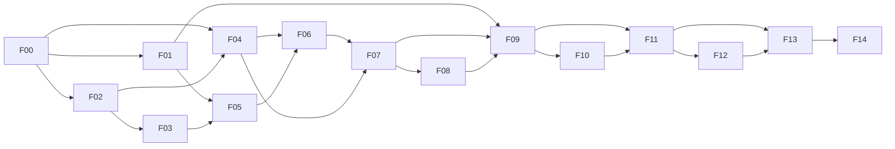

# Plan de tareas por fases

Versión 1.2 · 2026-10-17. Estado: F00 completada y G00 aprobada; F01/F02 en curso. Evidencia por ticket y [revisión de cierre F00](../../execution/f00-07-decisions.md).

Este plan conserva los IDs F00.01-F14.09 del PDF y enlaza cada trabajo con criterios EARS de [requirements.md](requirements.md). Las puertas y pruebas se definen en [validation.md](validation.md); Q01-Q14 en [decisions.md](decisions.md). El detalle de las 120 tareas está enlazado desde cada ticket. Las casillas solo se cierran con evidencia; los avances parciales no cierran las gates del PDF.

## Cómo ejecutar el backlog

Cada fase declara entradas y rutas futuras. Dentro de una fase, el orden de lista es la secuencia conservadora por defecto; una tarea depende de los artefactos previos que consume. F04 puede investigarse junto con F02/F03; audio básico e instrumentación empiezan en F01. La certificación F12 requiere G11 aunque los problemas bloqueantes de rendimiento se investigan antes. Los trabajos sintéticos no requieren originales ni cerrar Q02.

Cada casilla es un ticket o una plantilla de tickets. El objetivo de tamaño es una sesión de 2-4 horas, no una promesa de duración de investigación. Cuando la unidad comprende varios formatos, clips, estados, escenas, herramientas o perfiles, crear instancias `Fxx.yy/<unidad>` y ejecutarlas por separado. La casilla matriz solo se cierra al completar todas las instancias obligatorias. Si un experimento no cabe, cerrar un informe verificable de hallazgos y dividir el trabajo pendiente; no declarar el sistema implementado. F03.05 se divide, como mínimo, en contrato binario/fixtures, escritor y lector adversarial, en ese orden.

Los tickets heredan estos campos obligatorios del PDF p. 33: fase, objetivo, requisitos, dependencias, entradas autorizadas, rutas, implementación o experimento, prueba, aceptación, evidencia y riesgos. Antes de comenzar, concretar las rutas de la fase para la unidad elegida y la incógnita Q que afecta su resultado. Los recursos privados siguen la [política de custodia](../../private-data.md): excepción para la ISO local ignorada en `binaries`; extracciones externas. Investigación y documentación se aceptan con evidencia revisable; las tareas de implementación con código y pruebas, nunca stubs que devuelvan éxito.

Plantilla de instancia:

```text
ID / unidad / responsable:
Objetivo único y criterio EARS:
Dependencias concretas / puerta de entrada:
Entradas sintéticas o privadas autorizadas:
Rutas exactas que se modificarán:
Implementación o experimento acotado:
Caso V/T y resultado esperado:
Resultado observado / build o commit / evidencia:
Riesgos Q y hallazgos:
Estado y condición de aceptación:
```

## Dependencias y puntos de decisión



Si G04 + G05 no demuestran lógica portable y margen en consola, se revisa la estrategia antes de integrar campaña. G09 decide continuar, optimizar y repetir o proponer un cambio explícito de alcance. No se establece una fecha de finalización; se estima con evidencia después de M1 y M3.

## F00. Identificación, alcance y custodia

Fuente: PDF p. 14. **Entrada:** Sin dependencia; originales solo con autorización y copia disponible.

**Rutas previstas:** docs/compatibility/, content-manifests/, docs/adr/. **Salida:** puerta G00 y evidencia en `validation.md`.

- [x] **F00.01 — Confirmar modelo y launcher.**
  - Ticket detallado: [F00.01](tasks/F00.md#f0001). Estado: confirmado por el usuario; ver [destino](../../compatibility/target.json).
  - Resultado y aceptación: Modelo y modo previstos confirmados; selección de Q01 resuelta. Versiones/CPU y compatibilidad física continúan en Q01/F01/F13, conforme al alcance de F00.01 del PDF.
  - Requisitos: RNF12.01, RNF12.05. Evidencia: caso V/T correspondiente, build/commit o informe de investigación.

- [x] **F00.02 — Identificar edición y hashes.**
  - Ticket detallado: [F00.02](tasks/F00.md#f0002). Estado: completada; 113 archivos verificados e imagen coincidente con Redump 1064, versión 1.02 e idiomas catalogados. Ver [evidencia de cierre](../../execution/f00-02-edition-identification.md).
  - Resultado y aceptación: Perfil con todos los archivos requeridos verificados y originales de solo lectura; T01.
  - Requisitos: RF01.01, RF01.02. Evidencia: caso V/T correspondiente, build/commit o informe de investigación.

- [x] **F00.03 — Contrastar revisión candidata.**
  - Ticket detallado: [F00.03](tasks/F00.md#f0003). Estado: perfil europeo independiente; [comparación con candidato del PDF](../../compatibility/edition-comparison.md), sin equivalencia binaria asumida.
  - Resultado y aceptación: Comparación con referencia documentada y perfil separado si difiere, sin offsets prestados.
  - Requisitos: RF01.03, RF01.04, RF01.06. Evidencia: caso V/T correspondiente, build/commit o informe de investigación.

- [x] **F00.04 — Delimitar contenido por hito.**
  - Ticket detallado: [F00.04](tasks/F00.md#f0004). Estado: completada; español y Normal/Normal confirmados, alcance M0-M5 y obligaciones de variantes en [scope.md](../../scope.md); [evidencia de cierre](../../execution/f00-04-scope.md).
  - Resultado y aceptación: scope.md con idioma, dificultad, ruta, ramas, finales y exclusiones; Q03.
  - Requisitos: RF13.01, RF13.04. Evidencia: caso V/T correspondiente, build/commit o informe de investigación.

- [x] **F00.05 — Definir perfil y política de datos.**
  - Ticket detallado: [F00.05](tasks/F00.md#f0005). Estado: completada; perfil canónico validado contra su informe, [inventario de fuentes](../../compatibility/sources.md), política y regresiones de custodia; [evidencia de cierre](../../execution/f00-05-profile-custody.md).
  - Resultado y aceptación: game-profile, inventario de fuentes y política de datos privados coherente con la excepción ISO local ignorada.
  - Requisitos: RF01.01, RNF08.01. Evidencia: caso V/T correspondiente, build/commit o informe de investigación.

- [x] **F00.06 — Revisar procedencia inicial.**
  - Ticket detallado: [F00.06](tasks/F00.md#f0006). Estado: completada; [inventario de licencias](../../compatibility/licenses.md), versiones, origen y pendientes LIC01-LIC09; [evidencia de cierre](../../execution/f00-06-provenance.md). La distribución concreta y adopción de candidatos siguen pendientes.
  - Resultado y aceptación: Inventario de licencias y procedencia por candidato; componentes pendientes identificados.
  - Requisitos: RNF05.01, RNF08.03. Evidencia: caso V/T correspondiente, build/commit o informe de investigación.

- [x] **F00.07 — Registrar incógnitas y responsables.**
  - Ticket detallado: [F00.07](tasks/F00.md#f0007). Estado: completada; Q01-Q14 con estado, rol, riesgo, evidencia, siguiente acción y criterios de cierre. [Informe y aprobación G00](../../execution/f00-07-decisions.md); G01-G14 pendientes.
  - Resultado y aceptación: Q01-Q14 asignadas a roles, riesgos y criterio de cierre; revisión documental.
  - Requisitos: RNF07.01, RNF12.01. Evidencia: caso V/T correspondiente, build/commit o informe de investigación.

## F01. Entorno reproducible y diagnóstico

Fuente: PDF p. 15. **Entrada:** G00 para datos privados; infraestructura sintética puede adelantarse.

**Rutas previstas:** engine/platform/host/, engine/platform/3ds/, engine/ports/, tests/fixtures/synthetic/, docs/compatibility/. **Salida:** puerta G01 y evidencia en `validation.md`.

- [x] **F01.01 — Fijar toolchain y construir ejemplo.**
  - Ticket detallado: [F01.01](tasks/F01.md#f0101). Estado: completada; ejemplo oficial reproducible, C++17 ARM, build propio limpio, regresiones e integración CI; [evidencia](../../execution/f01-01-toolchain.md). Ejecución física y CI remota pendientes.
  - Resultado y aceptación: Manifiesto de versiones/licencias y ejemplo oficial reproducible; C++17 comprobado.
  - Requisitos: RNF05.01, RNF05.02. Evidencia: caso V/T correspondiente, build/commit o informe de investigación.

- [ ] **F01.02 — Crear aplicación sintética .3dsx.**
  - Ticket detallado: [F01.02](tasks/F01.md#f0102). Estado: implementación y validación local completadas; 14 casos CTest y build ARM. Instancia `F01.02/hardware` pendiente; [informe](../../execution/f01-02-diagnostic.md) y [prueba de arranque](../../compatibility/diagnostic-startup.md).
  - Resultado y aceptación: Geometría, entrada y salida controlada; composición explícita y prueba de inicio.
  - Requisitos: RNF12.02, RNF11.01, RNF11.03, RF12.04. Evidencia: caso V/T correspondiente, build/commit o informe de investigación.

- [ ] **F01.03 — Verificar archivos y configuración.**
  - Ticket detallado: [F01.03](tasks/F01.md#f0103). Implementación y validación local completadas; 21 casos CTest, archivos reales host/fallos inyectados y build ARM. [Informe](../../execution/f01-03-files.md); `F01.03/hardware` y su dependencia `F01.02/hardware` pendientes.
  - Resultado y aceptación: Lectura SD, escritura de opciones y archivo ausente con error tipado; V11/V17.
  - Requisitos: RNF03.04, RF11.06, RF14.01. Evidencia: caso V/T correspondiente, build/commit o informe de investigación.

- [ ] **F01.04 — Probar tono y servicio de audio.**
  - Ticket detallado: [F01.04](tasks/F01.md#f0104). Implementación y validación local completadas; 31 casos CTest, fallos NDSP/PCM/flush y build ARM. [Informe](../../execution/f01-04-audio.md); `F01.04/hardware` y dependencias físicas pendientes.
  - Resultado y aceptación: Tono PCM sintético, resultado de inicialización y contador; fallo explicado.
  - Requisitos: RF08.06, RF14.01. Evidencia: caso V/T correspondiente, build/commit o informe de investigación.

- [ ] **F01.05 — Verificar emulador y depuración real.**
  - Ticket detallado: [F01.05](tasks/F01.md#f0105). Herramientas de integridad y breakpoints en Azahar comprobados; [informe](../../execution/f01-05-debugging.md). Consola y anomalía de refresco tras reconexión pendientes.
  - Resultado y aceptación: Ejecución en Azahar y consola; breakpoint/error de prueba con símbolos del mismo build.
  - Requisitos: RF14.03, RNF12.01. Evidencia: caso V/T correspondiente, build/commit o informe de investigación.

- [ ] **F01.06 — Medir recursos y configurar diagnóstico.**
  - Ticket detallado: [F01.06](tasks/F01.md#f0106). Instrumentación y protocolo diagnostic-v1 implementados; validación en [informe](../../execution/f01-06-resources.md). Medición física de B_app/CPU/launcher pendiente.
  - Resultado y aceptación: B_app, pools, CPU y launcher registrados; logs acotados y métricas por sistema con Q13 inicial.
  - Requisitos: RNF02.01, RF14.02, RNF01.05. Evidencia: caso V/T correspondiente, build/commit o informe de investigación.

- [ ] **F01.07 — Probar ciclo de vida y controles reservados.**
  - Ticket detallado: [F01.07](tasks/F01.md#f0107). Implementación local de suspensión, hooks idempotentes, liberación de botones y controles reservados; 47 casos CTest. [Informe](../../execution/f01-07-lifecycle.md); tapa/HOME/retorno físicos pendientes.
  - Resultado y aceptación: Pausa/suspensión/reanudación/salida documentadas con estado esperado; V12.
  - Requisitos: RF12.01, RF12.02, RF12.03, RF11.04. Evidencia: caso V/T correspondiente, build/commit o informe de investigación.

- [ ] **F01.08 — Automatizar builds y diagnóstico de cierre.**
  - Ticket detallado: [F01.08](tasks/F01.md#f0108). Automatización local verificada: 295 tests Python, 47 CTest, build ARM limpio y recibo completo. [Informe](../../execution/f01-08-builds.md); CI remota, treinta minutos físicos y cierre G01 pendientes.
  - Resultado y aceptación: Build host/3DS limpio con datos sintéticos; treinta minutos en consola y error simbolizado.
  - Requisitos: RNF05.02, RNF03.01, RNF08.02, RNF04.01, RNF07.06, RNF07.07, RNF07.08, RNF07.09. Evidencia: caso V/T correspondiente, build/commit o informe de investigación.

## F02. Inventario y extracción

Fuente: PDF p. 16. **Entrada:** G00 y herramientas de inspección verificadas en F01.

**Rutas previstas:** tools/inspectors/, tools/pipeline/, content-manifests/, tests/fixtures/synthetic/. **Salida:** puerta G02 y evidencia en `validation.md`.

- [x] **F02.01 — Enumerar archivos y contenedores.**
  - Ticket detallado: [F02.01](tasks/F02.md#f0201). Completada para el nivel ISO: dos catálogos idénticos de 113 archivos con IDs, offsets, clasificación y desconocidos; 357 tests Python. [Informe](../../execution/f02-01-inventory.md). Entradas internas, extracción y G02 pendientes.
  - Resultado y aceptación: Catálogo de ruta, tamaño y hash; identificación sustentada sin depender solo de extensión.
  - Requisitos: RF01.02, RF02.01. Evidencia: caso V/T correspondiente, build/commit o informe de investigación.

- [x] **F02.02 — Evaluar extractor MFA candidato.**
  - Ticket detallado: [F02.02](tasks/F02.md#f0202). Evaluación completada: candidato GUI no adoptado; alternativa propia de sondeo D8 contrastada dos veces, 430 tests Python. [Informe](../../execution/f02-02-mfa-candidate.md). Extracción/G02 pendientes.
  - Resultado y aceptación: Candidato fijado y alternativa documentada con salidas revisadas: B0/MV0 estructurales, 60 desconocidos. Se usa lectura directa de la copia ISO identificada; no se exportan recursos.
  - Requisitos: RNF05.01, RNF05.04, RF02.02. Evidencia: caso V/T correspondiente, build/commit o informe de investigación.

- [x] **F02.03 — Investigar una variante adicional de contenedor.**
  - Ticket detallado: [F02.03](tasks/F02.md#f0203). B8 contrastado: 59 archivos/1693 entradas; XBG0 investigado con codificación pendiente. Unión con D8: 61 archivos/1740 entradas estructurales; 493 pruebas. [Informe](../../execution/f02-03-container-variants.md). G02/extracción pendientes.
  - Resultado y aceptación: Adaptador o informe de desconocido por variante; fixture y límites observados.
  - Requisitos: RF02.02, RNF06.01. Evidencia: caso V/T correspondiente, build/commit o informe de investigación.

- [x] **F02.04 — Catalogar entradas y dependencias.**
  - Ticket detallado: [F02.04](tasks/F02.md#f0204). Completada para 61 MFA/1740 recursos: dos catálogos idénticos con IDs/rangos/SHA-256, 582 pruebas. Tipos/dependencias sin inspeccionar, XBG0 desconocido y 51 archivos ISO fuera del alcance interno; no exportación. [Informe](../../execution/f02-04-asset-catalog.md).
  - Resultado y aceptación: Cada entrada del contenedor seleccionado tiene ID, offset, tamaño y dependencias conocidas.
  - Requisitos: RF02.01, RF02.07. Evidencia: caso V/T correspondiente, build/commit o informe de investigación.

- [x] **F02.05 — Repetir extracción en dos directorios vacíos.**
  - Ticket detallado: [F02.05](tasks/F02.md#f0205). Completada para 61 MFA/1740 recursos: dos copias externas verificadas, listas/tamaños/SHA-256 idénticos entre sí y contra F02.04; 686 pruebas. [Informe](../../execution/f02-05-repeatable-extraction.md). XBG0/AFS y corpus pendientes.
  - Resultado y aceptación: Hashes idénticos y registro de pasos manuales pendientes; V02.
  - Requisitos: RF02.03, RNF05.03. Evidencia: caso V/T correspondiente, build/commit o informe de investigación.

- [x] **F02.06 — Endurecer extracción por variante.**
  - Ticket detallado: [F02.06](tasks/F02.md#f0206). Completada para B8/D8/exportador actual: 142 casos nuevos, correcciones de limpieza/propiedad y estado final; 828 pruebas aprobadas. [Informe](../../execution/f02-06-extraction-hardening.md). Extracción real histórica preservada, sin formatos nuevos ni cierre de G02.
  - Resultado y aceptación: Pruebas de tamaños/rangos, rutas absolutas y escape del destino; T02.
  - Requisitos: RNF06.01, RNF06.04, RNF06.07. Evidencia: caso V/T correspondiente, build/commit o informe de investigación.

- [ ] **F02.07 — Seleccionar corpus mínimo representativo.**
  - Ticket detallado: [F02.07](tasks/F02.md#f0207). Contrato/lector/inventario inicial completados: 1740 candidatos, dos informes idénticos y 919 pruebas aprobadas. [Informe parcial](../../execution/f02-07-slice-corpus.md). [Sondeo de cámara completado](../../execution/f02-07-camera-probe.md) para 285 indicios, sin identificación semántica; 985 pruebas aprobadas. [Búsqueda estática europea completada](../../execution/f02-07-camera-consumer.md): dos sitios candidatos, vínculo de recurso sin demostrar, 1101 pruebas aprobadas. [Seguimiento del puntero completado como investigación parcial](../../execution/f02-07-camera-pointer.md): referencia externa en A y dos barreras de llamada en B, sin vínculo de recurso; 1240 pruebas aprobadas. [Fronteras de llamada investigadas](../../execution/f02-07-camera-boundary.md): A recibe GPR4 desde GPR6 en el slot; efectos de B sin demostrar; 1307 pruebas y dos informes idénticos. [Plan/contrato/validador completados](../../execution/f02-07-camera-observation.md): 1435 pruebas, dos planes idénticos y PCSX2 v2.8.2 con perfil privado comprobado. [BIOS principal configurada y arranque comprobado por logs](../../execution/f02-07-ps2-boot.md). [Primera tentativa de ejecución](../../execution/f02-07-camera-runtime-attempt.md): nueve breakpoints, seis rangos coincidentes y aviso de tarjeta observado; dos recibos `validated_no_observations`, 128 pruebas del validador aprobadas. [Captura posterior completada](../../execution/f02-07-camera-runtime-capture.md): nueve eventos de tres invocaciones, seis rangos coincidentes y dos recibos `validated_observations`. A cambia GPR4 al retorno; B1/B2 conservan GPR16 en estas invocaciones. 82 casos nuevos, 1.517 pruebas Python aprobadas. [Búsqueda exacta completada](../../execution/f02-07-camera-resource-link.md): diez muestras, seis hits sobre un candidato de 1.536 bytes y dos informes idénticos; 1.583 pruebas Python aprobadas. [Comparación completa del candidato](../../execution/f02-07-camera-origin.md): igualdad de 1.536 bytes en entrada A y cambio de 40 bytes al retornar; dos informes idénticos, 66 casos nuevos y 1.649 pruebas aprobadas. [Primera escritura observada durante A](../../execution/f02-07-camera-writer.md): siete estados, dos pares validados (uno sin cambio y otro BEQ+SW con tres bytes modificados), dos recibos idénticos y 1.720 pruebas aprobadas. [Repetición con retorno completada](../../execution/f02-07-camera-return.md): nueva sesión con el mismo par y los 1.536 bytes de retorno idénticos al histórico; dos recibos iguales, 38 pruebas nuevas y 1.758 pruebas aprobadas. [Contrato y factibilidad del mapa efectivo](../../execution/f02-07-effective-mapping.md): 91 casos nuevos y 1.849 pruebas aprobadas; lectura externa denegada por macOS (EPERM), captura real pendiente. [Preparación del build aislado](../../execution/f02-07-pcsx2-build.md): checkout limpio fijado, fixture C++20/x86_64 aprobado y 1.897 pruebas Python; libpng/APNG x86_64 compilada y 37 pruebas aprobadas; tres configuraciones diagnósticas conservadas, la última detenida ante JPEG. Xcode 26.6 y Metal instalados; los cuatro ensayos del toolchain pasan con selección explícita por proceso. [SRC32: lote de dependencias completado](../../execution/f02-07-pcsx2-dependencies.md): NASM validado, JPEG con 332/332 pruebas y Zstd/LZ4/WebP x86_64 probados; CMake limpio avanza hasta SDL3. Reserva inicial de espacio verificada tras la respuesta del usuario; al cerrar queda por debajo del margen para builds grandes. [SRC33: SDL3 3.4.12 completada](../../execution/f02-07-pcsx2-sdl3.md): aislamiento adicional de pkg-config, pruebas del proveedor con omisiones explícitas, cuatro casos propios antes/después de instalar y rechazo de prefijo incorrecto. La quinta configuración supera SDL3 y alcanza FreeType. [SRC34: FreeType/HarfBuzz completados](../../execution/f02-07-pcsx2-fonts.md): dos pasadas FreeType 2.14.3 y HarfBuzz 14.2.0, cinco dylibs x86_64; siete casos propios en la instalación final, fuentes sintéticas y enlace privado verificados. Suites de proveedor no ejecutadas; nueve descargas de receta verificadas más NASM/FontTools auxiliares. La sexta configuración supera FreeType y alcanza PlutoVG. [SRC35: PlutoVG/PlutoSVG completados](../../execution/f02-07-pcsx2-pluto.md): versiones 1.3.2/0.0.7 x86_64, ocho casos propios en la instalación final y glifo SVG renderizado mediante FreeType; negativos de paquetes aprobados. Once archivos de receta verificados; la séptima configuración alcanza ryml. Sigue `origin/effective-mapping/instrumented-build/prerequisites/dependencies-rapidyaml`; otros escritores y carga anterior siguen pendientes. Dependencias y dos salas conectadas requieren evidencia antes de cerrar F02.07.
  - Resultado y aceptación: Escenario, personaje, animación, alpha, colisión, texto, sonido y secuencia localizados; bloqueos explícitos.
  - Requisitos: RF02.02, RF02.08, RF13.02. Evidencia: caso V/T correspondiente, build/commit o informe de investigación.

## F03. Decodificación y conversión

Fuente: PDF p. 17. **Entrada:** G02; puede solaparse con investigación F04.

**Rutas previstas:** tools/pipeline/, tools/validators/, schemas/, recipes/, tests/fixtures/synthetic/. **Salida:** puerta G03 y evidencia en `validation.md`.

- [ ] **F03.01 — Verificar cobertura de un plugin/formato.**
  - Ticket detallado: [F03.01](tasks/F03.md#f0301).
  - Resultado y aceptación: Matriz por formato y revisión con salida inspeccionada; no atribuir soporte no probado.
  - Requisitos: RF02.02, RNF05.01. Evidencia: caso V/T correspondiente, build/commit o informe de investigación.

- [ ] **F03.02 — Decodificar un tipo de recurso del slice.**
  - Ticket detallado: [F03.02](tasks/F03.md#f0302).
  - Resultado y aceptación: Fixture y datos de malla/material/textura/esqueleto/animación/colisión/cámara; eventos desconocidos separados.
  - Requisitos: RF02.04, RF02.05, RF02.08. Evidencia: caso V/T correspondiente, build/commit o informe de investigación.

- [ ] **F03.03 — Fijar convenciones geométricas y temporales.**
  - Ticket detallado: [F03.03](tasks/F03.md#f0303).
  - Resultado y aceptación: Documento de ejes/unidades/matrices/winding/UV/pose/interpolación y fixture que detecta inversiones.
  - Requisitos: RF02.05, RF03.01, RF04.04. Evidencia: caso V/T correspondiente, build/commit o informe de investigación.

- [ ] **F03.04 — Estabilizar intermedio y exportación de inspección.**
  - Ticket detallado: [F03.04](tasks/F03.md#f0304).
  - Resultado y aceptación: Esquema lógico y round-trip de fixture sin pérdida de metadatos; representación conservada.
  - Requisitos: RF02.04, RF02.05. Evidencia: caso V/T correspondiente, build/commit o informe de investigación.

- [ ] **F03.05 — Especificar y probar SH3P.**
  - Ticket detallado: [F03.05](tasks/F03.md#f0305).
  - Resultado y aceptación: Layout exacto y límites aprobados antes del lector; escritor/lector comparten fixtures válidos e inválidos.
  - Requisitos: RF01.05, RNF06.01, RNF06.02, RNF06.05, RNF06.06, RNF06.07. Evidencia: caso V/T correspondiente, build/commit o informe de investigación.

- [ ] **F03.06 — Convertir un material y empaquetar sector.**
  - Ticket detallado: [F03.06](tasks/F03.md#f0306).
  - Resultado y aceptación: Receta versionada, pérdidas declaradas y paquete idéntico en dos ejecuciones limpias.
  - Requisitos: RF02.03, RF02.06, RF03.02, RNF09.02. Evidencia: caso V/T correspondiente, build/commit o informe de investigación.

- [ ] **F03.07 — Probar datos malformados por lector.**
  - Ticket detallado: [F03.07](tasks/F03.md#f0307).
  - Resultado y aceptación: Truncamiento, índices/huesos inválidos, no finitos y tamaño descomprimido excesivo rechazados; T02.
  - Requisitos: RNF06.01, RNF06.02, RNF06.03, RNF06.07. Evidencia: caso V/T correspondiente, build/commit o informe de investigación.

- [ ] **F03.08 — Reportar bytes, cobertura y faltantes.**
  - Ticket detallado: [F03.08](tasks/F03.md#f0308).
  - Resultado y aceptación: Reporte por categoría y dependencias; pose/animación coherentes, sin pérdida crítica silenciosa para G03.
  - Requisitos: RF02.07, RF02.08, RNF07.02. Evidencia: caso V/T correspondiente, build/commit o informe de investigación.

## F04. Comportamiento y portabilidad

Fuente: PDF p. 18. **Entrada:** G00, ejecutable identificado y corpus de F02. Puede investigarse mientras avanza F03.

**Rutas previstas:** docs/reverse-engineering/, engine/recovered/, engine/domain/, engine/ports/, tests/differential/. **Salida:** puerta G04 y evidencia en `validation.md`.

- [ ] **F04.01 — Preparar análisis de ejecutable identificado.**
  - Ticket detallado: [F04.01](tasks/F04.md#f0401).
  - Resultado y aceptación: Ghidra/extensión EE compatibles y observación PCSX2 trazable para una función.
  - Requisitos: RNF05.01, RNF04.02. Evidencia: caso V/T correspondiente, build/commit o informe de investigación.

- [ ] **F04.02 — Inventariar subsistemas críticos.**
  - Ticket detallado: [F04.02](tasks/F04.md#f0402).
  - Resultado y aceptación: Mapa de bucle, carga, jugador, cámara, colisión, inventario, eventos, enemigos, audio y guardado.
  - Requisitos: RNF04.03, RF13.07. Evidencia: caso V/T correspondiente, build/commit o informe de investigación.

- [ ] **F04.03 — Relacionar identidad de función y módulo.**
  - Ticket detallado: [F04.03](tasks/F04.md#f0403).
  - Resultado y aceptación: Registro edición/módulo/dirección; overlays no tratados como direcciones universales.
  - Requisitos: RNF04.02, RF01.04. Evidencia: caso V/T correspondiente, build/commit o informe de investigación.

- [ ] **F04.04 — Documentar contrato de una función.**
  - Ticket detallado: [F04.04](tasks/F04.md#f0404).
  - Resultado y aceptación: Entradas/salidas, estructuras, efectos, precisión y dependencias PS2 con evidencia.
  - Requisitos: RNF04.02, RNF09.01. Evidencia: caso V/T correspondiente, build/commit o informe de investigación.

- [ ] **F04.05 — Clasificar estrategia por dependencia crítica.**
  - Ticket detallado: [F04.05](tasks/F04.md#f0405).
  - Resultado y aceptación: C reutilizable/adaptable, ensamblador, VU/GS/IOP o reimplementación; ruta del slice sin incógnita crítica omitida.
  - Requisitos: RNF04.03, RF13.07. Evidencia: caso V/T correspondiente, build/commit o informe de investigación.

- [ ] **F04.06 — Crear arnés host de lógica real.**
  - Ticket detallado: [F04.06](tasks/F04.md#f0406).
  - Resultado y aceptación: Movimiento, transición de estado e inventario ejecutables sin gráficos; fixtures por función.
  - Requisitos: RNF04.01, RNF04.04, RF04.01, RF06.01. Evidencia: caso V/T correspondiente, build/commit o informe de investigación.

- [ ] **F04.07 — Comparar estados y vectores.**
  - Ticket detallado: [F04.07](tasks/F04.md#f0407).
  - Resultado y aceptación: Flags/inventario exactos y tolerancia por coordenada justificada; no margen global arbitrario.
  - Requisitos: RNF09.01, RF04.01, RF06.02. Evidencia: caso V/T correspondiente, build/commit o informe de investigación.

- [ ] **F04.08 — Sustituir una dependencia de plataforma.**
  - Ticket detallado: [F04.08](tasks/F04.md#f0408).
  - Resultado y aceptación: Puerto pequeño y doble host con equivalencia; código recuperado aislado y vida útil explícita.
  - Requisitos: RNF11.01, RNF11.02, RNF11.03, RNF11.04, RNF04.03, RNF11.05, RNF11.06, RNF11.07, RNF11.08, RNF11.09. Evidencia: caso V/T correspondiente, build/commit o informe de investigación.

- [ ] **F04.09 — Fijar contrato temporal observado.**
  - Ticket detallado: [F04.09](tasks/F04.md#f0409).
  - Resultado y aceptación: Tick/animación/presentación y política de pausa documentados; T05 inicial.
  - Requisitos: RF04.02, RF12.01, RF12.02, RNF04.04. Evidencia: caso V/T correspondiente, build/commit o informe de investigación.

## F05. Renderizador y escena representativa

Fuente: PDF p. 19. **Entrada:** G01 y G03 para corpus visual.

**Rutas previstas:** engine/platform/3ds/render/, engine/ports/, recipes/, docs/benchmarks/. **Salida:** puerta G05 y evidencia en `validation.md`.

- [ ] **F05.01 — Implementar un corte del backend gráfico.**
  - Ticket detallado: [F05.01](tasks/F05.md#f0501).
  - Resultado y aceptación: Buffers, matrices, cámara, material/textura y profundidad con propiedad RAII y errores.
  - Requisitos: RF03.01, RF03.02, RNF11.04. Evidencia: caso V/T correspondiente, build/commit o informe de investigación.

- [ ] **F05.02 — Validar patrón y habitación identificada.**
  - Ticket detallado: [F05.02](tasks/F05.md#f0502).
  - Resultado y aceptación: Ejes/caras sintéticos y luego landmarks de la habitación; capturas comparables.
  - Requisitos: RF03.01, RF03.05. Evidencia: caso V/T correspondiente, build/commit o informe de investigación.

- [ ] **F05.03 — Decidir política de encuadre.**
  - Ticket detallado: [F05.03](tasks/F05.md#f0503).
  - Resultado y aceptación: ADR con bandas 4:3 o campo ampliado por juego/cinemática; sin deformación.
  - Requisitos: RF03.04, RNF09.02. Evidencia: caso V/T correspondiente, build/commit o informe de investigación.

- [ ] **F05.04 — Añadir variantes de material.**
  - Ticket detallado: [F05.04](tasks/F05.md#f0504).
  - Resultado y aceptación: Opaco/recorte/transparencia y caso alpha/doble cara contrastados; T03.
  - Requisitos: RF03.02, RNF09.01. Evidencia: caso V/T correspondiente, build/commit o informe de investigación.

- [ ] **F05.05 — Probar luz, niebla y linterna por material.**
  - Ticket detallado: [F05.05](tasks/F05.md#f0505).
  - Resultado y aceptación: Aproximación medida y diferencias aceptadas con captura por caso.
  - Requisitos: RF03.03, RNF09.02. Evidencia: caso V/T correspondiente, build/commit o informe de investigación.

- [ ] **F05.06 — Añadir culling, lotes y residencia.**
  - Ticket detallado: [F05.06](tasks/F05.md#f0506).
  - Resultado y aceptación: Comandos agrupados, recursos persistentes y sin creación de texturas por frame; medición antes/después.
  - Requisitos: RNF01.05, RNF02.06, RNF11.02. Evidencia: caso V/T correspondiente, build/commit o informe de investigación.

- [ ] **F05.07 — Medir curvas de coste del corpus.**
  - Ticket detallado: [F05.07](tasks/F05.md#f0507).
  - Resultado y aceptación: Coste de malla/draw calls/transparencia/transferencias/estados y margen para otros sistemas.
  - Requisitos: RNF01.01, RNF02.07, RNF02.02. Evidencia: caso V/T correspondiente, build/commit o informe de investigación.

- [ ] **F05.08 — Comparar escena y cerrar G05.**
  - Ticket detallado: [F05.08](tasks/F05.md#f0508).
  - Resultado y aceptación: Orientación/proporciones/máscaras/legibilidad correctas, memoria/frame reales y riesgos pendientes registrados.
  - Requisitos: RF03.05, RNF09.02, RF13.07. Evidencia: caso V/T correspondiente, build/commit o informe de investigación.

## F06. Personaje, controles, cámara y colisión

Fuente: PDF p. 20. **Entrada:** G04 y G05.

**Rutas previstas:** engine/domain/, engine/application/, engine/platform/3ds/input/, tests/differential/, docs/benchmarks/. **Salida:** puerta G06 y evidencia en `validation.md`.

- [ ] **F06.01 — Implementar intención y movimiento resuelto.**
  - Ticket detallado: [F06.01](tasks/F06.md#f0601).
  - Resultado y aceptación: Controlador con contrato temporal F04; entrada grabada llega al estado previsto.
  - Requisitos: RF04.01, RF04.02. Evidencia: caso V/T correspondiente, build/commit o informe de investigación.

- [ ] **F06.02 — Integrar un clip y sus transiciones.**
  - Ticket detallado: [F06.02](tasks/F06.md#f0602).
  - Resultado y aceptación: Instancias idle/caminar/correr/girar con raíz aplicada una vez; T04.
  - Requisitos: RF04.03, RF04.04. Evidencia: caso V/T correspondiente, build/commit o informe de investigación.

- [ ] **F06.03 — Medir alternativa de skinning.**
  - Ticket detallado: [F06.03](tasks/F06.md#f0603).
  - Resultado y aceptación: Comparación CPU/GPU y límite de huesos/influencias sustentado; elección registrada.
  - Requisitos: RNF02.07, RNF01.05. Evidencia: caso V/T correspondiente, build/commit o informe de investigación.

- [ ] **F06.04 — Implementar una zona de cámara.**
  - Ticket detallado: [F06.04](tasks/F06.md#f0604).
  - Resultado y aceptación: Cambio, interpolación y restricciones comparados; cámara debug marcada provisional.
  - Requisitos: RF04.05, RF04.06. Evidencia: caso V/T correspondiente, build/commit o informe de investigación.

- [ ] **F06.05 — Resolver una clase de colisión/activador.**
  - Ticket detallado: [F06.05](tasks/F06.md#f0605).
  - Resultado y aceptación: Pared/esquina/puerta/escalón/pendiente del corpus con fixture y sin penetración persistente.
  - Requisitos: RF05.01, RF05.02. Evidencia: caso V/T correspondiente, build/commit o informe de investigación.

- [ ] **F06.06 — Crear mapeo completo reasignable.**
  - Ticket detallado: [F06.06](tasks/F06.md#f0606).
  - Resultado y aceptación: Todas las acciones y combinaciones simultáneas probadas, sin invadir reservas del sistema.
  - Requisitos: RF11.01, RF11.02, RF11.04. Evidencia: caso V/T correspondiente, build/commit o informe de investigación.

- [ ] **F06.07 — Validar juego sin táctil obligatorio.**
  - Ticket detallado: [F06.07](tasks/F06.md#f0607).
  - Resultado y aceptación: Combate básico accesible por controles físicos y accesos táctiles complementarios.
  - Requisitos: RF11.03, RF11.05. Evidencia: caso V/T correspondiente, build/commit o informe de investigación.

- [ ] **F06.08 — Ejecutar navegación de aceptación.**
  - Ticket detallado: [F06.08](tasks/F06.md#f0608).
  - Resultado y aceptación: Treinta minutos junto a límites/cámaras, render lento y estado final previsto; T04/T05.
  - Requisitos: RF04.02, RF05.01, RNF03.02. Evidencia: caso V/T correspondiente, build/commit o informe de investigación.

## F07. Progreso y persistencia temprana

Fuente: PDF p. 21. **Entrada:** G04 y G06.

**Rutas previstas:** engine/domain/, engine/application/save/, engine/platform/3ds/ui/, schemas/, tests/integration/. **Salida:** puerta G07 y evidencia en `validation.md`.

- [ ] **F07.01 — Documentar una interacción y puerta.**
  - Ticket detallado: [F07.01](tasks/F07.md#f0701).
  - Resultado y aceptación: IDs, condiciones, flags y efectos observados sin inventar scripting original.
  - Requisitos: RF05.02, RF06.04, RNF09.01. Evidencia: caso V/T correspondiente, build/commit o informe de investigación.

- [ ] **F07.02 — Implementar acciones de inventario.**
  - Ticket detallado: [F07.02](tasks/F07.md#f0702).
  - Resultado y aceptación: Examinar/recoger/usar/equipar y rechazo con fixture por acción; T07.
  - Requisitos: RF06.01, RF06.02, RF06.03. Evidencia: caso V/T correspondiente, build/commit o informe de investigación.

- [ ] **F07.03 — Integrar clave, consumible y texto.**
  - Ticket detallado: [F07.03](tasks/F07.md#f0703).
  - Resultado y aceptación: Circuito mínimo y uso fallido sin consumo ni efectos incorrectos.
  - Requisitos: RF06.07, RF06.02. Evidencia: caso V/T correspondiente, build/commit o informe de investigación.

- [ ] **F07.04 — Definir orden e idempotencia de eventos.**
  - Ticket detallado: [F07.04](tasks/F07.md#f0704).
  - Resultado y aceptación: Caso de disparos repetidos y secuencia completada sin reejecución.
  - Requisitos: RF06.05, RF06.06. Evidencia: caso V/T correspondiente, build/commit o informe de investigación.

- [ ] **F07.05 — Conectar dos habitaciones con retorno.**
  - Ticket detallado: [F07.05](tasks/F07.md#f0705).
  - Resultado y aceptación: Estado persistente preservado y destino inválido sin confirmar transición; T06 inicial.
  - Requisitos: RF05.03, RF05.04, RF05.05. Evidencia: caso V/T correspondiente, build/commit o informe de investigación.

- [ ] **F07.06 — Implementar dos generaciones de guardado.**
  - Ticket detallado: [F07.06](tasks/F07.md#f0706).
  - Resultado y aceptación: Esquema, selección de secuencia íntegra e interrupción por paso; ninguna válida produce diagnóstico.
  - Requisitos: RF10.01, RF10.02, RF10.03, RF10.04, RF10.08. Evidencia: caso V/T correspondiente, build/commit o informe de investigación.

- [ ] **F07.07 — Probar cierre y recarga de progreso.**
  - Ticket detallado: [F07.07](tasks/F07.md#f0707).
  - Resultado y aceptación: Recoger/abrir/cambiar/guardar/cerrar/continuar sin duplicaciones ni flags reiniciados; T07/T10.
  - Requisitos: RF06.06, RF10.05, RF10.06. Evidencia: caso V/T correspondiente, build/commit o informe de investigación.

- [ ] **F07.08 — Presentar inventario y mensajes.**
  - Ticket detallado: [F07.08](tasks/F07.md#f0708).
  - Resultado y aceptación: UI separada de dominio, legible en consola y navegación de todas las acciones.
  - Requisitos: RF11.05, RNF11.01, RNF11.02. Evidencia: caso V/T correspondiente, build/commit o informe de investigación.

## F08. Enemigos y combate

Fuente: PDF p. 22. **Entrada:** G06 y sistema de estados de G07.

**Rutas previstas:** engine/domain/, engine/application/, tests/differential/, docs/benchmarks/. **Salida:** puerta G08 y evidencia en `validation.md`.

- [ ] **F08.01 — Caracterizar un enemigo y un arma.**
  - Ticket detallado: [F08.01](tasks/F08.md#f0801).
  - Resultado y aceptación: Estados, distancias, tiempos y efectos de referencia documentados por edición.
  - Requisitos: RF07.01, RNF09.01. Evidencia: caso V/T correspondiente, build/commit o informe de investigación.

- [ ] **F08.02 — Implementar una transición de enemigo.**
  - Ticket detallado: [F08.02](tasks/F08.md#f0802).
  - Resultado y aceptación: Percepción/movimiento/ataque/interrupción/daño/muerte con fixture por transición.
  - Requisitos: RF07.01, RF07.05. Evidencia: caso V/T correspondiente, build/commit o informe de investigación.

- [ ] **F08.03 — Integrar ventana de impacto.**
  - Ticket detallado: [F08.03](tasks/F08.md#f0803).
  - Resultado y aceptación: Daño por evento de animación dentro de ventana, nunca continuo por frame; T08.
  - Requisitos: RF07.02, RF04.02. Evidencia: caso V/T correspondiente, build/commit o informe de investigación.

- [ ] **F08.04 — Resolver colisión de combate y consumo.**
  - Ticket detallado: [F08.04](tasks/F08.md#f0804).
  - Resultado y aceptación: Hitboxes, reacción, invulnerabilidad y recursos válidos en ataque fallido/simultáneo.
  - Requisitos: RF07.03, RF07.05. Evidencia: caso V/T correspondiente, build/commit o informe de investigación.

- [ ] **F08.05 — Implementar muerte y continuación.**
  - Ticket detallado: [F08.05](tasks/F08.md#f0805).
  - Resultado y aceptación: Retorno desde muerte restaura generación válida sin bloqueo.
  - Requisitos: RF07.04, RF10.03. Evidencia: caso V/T correspondiente, build/commit o informe de investigación.

- [ ] **F08.06 — Comparar casos adversos de combate.**
  - Ticket detallado: [F08.06](tasks/F08.md#f0806).
  - Resultado y aceptación: Impacto válido/fallido, daño simultáneo, enemigo bloqueado y salida de habitación equivalentes.
  - Requisitos: RF07.02, RF07.03, RF07.05. Evidencia: caso V/T correspondiente, build/commit o informe de investigación.

- [ ] **F08.07 — Medir varios enemigos del corpus.**
  - Ticket detallado: [F08.07](tasks/F08.md#f0807).
  - Resultado y aceptación: Número realmente probado, costes IA/animación/colisión y estados finales documentados.
  - Requisitos: RNF02.07, RNF01.05. Evidencia: caso V/T correspondiente, build/commit o informe de investigación.

- [ ] **F08.08 — Cerrar diferencias y reglas.**
  - Ticket detallado: [F08.08](tasks/F08.md#f0808).
  - Resultado y aceptación: Simplificaciones visuales separadas de dificultad/cantidad; G08 con casos aprobados.
  - Requisitos: RF07.06, RNF09.02, RNF09.03. Evidencia: caso V/T correspondiente, build/commit o informe de investigación.

## F09. Audio, streaming y vertical slice

Fuente: PDF p. 23. **Entrada:** G07, G08 y audio sintético de G01.

**Rutas previstas:** engine/platform/3ds/audio/, engine/application/streaming/, recipes/, tests/integration/, docs/benchmarks/. **Salida:** puerta G09 y evidencia en `validation.md`.

- [ ] **F09.01 — Convertir audio e iniciar streaming.**
  - Ticket detallado: [F09.01](tasks/F09.md#f0901).
  - Resultado y aceptación: Loops/duración/canales/niveles conservados y buffers explícitos para un stream representativo.
  - Requisitos: RF08.01, RF08.02, RNF02.06. Evidencia: caso V/T correspondiente, build/commit o informe de investigación.

- [ ] **F09.02 — Aplicar prioridades de audio.**
  - Ticket detallado: [F09.02](tasks/F09.md#f0902).
  - Resultado y aceptación: Música/ambiente/voz/efectos bajo saturación; treinta minutos sin underruns/clipping no previsto.
  - Requisitos: RF08.03, RF08.04. Evidencia: caso V/T correspondiente, build/commit o informe de investigación.

- [ ] **F09.03 — Implementar residencia por sector.**
  - Ticket detallado: [F09.03](tasks/F09.md#f0903).
  - Resultado y aceptación: Caché/dependencias compartidas/precarga limitada y liberación tras GPU/audio; OOM controlado.
  - Requisitos: RF05.04, RF05.05, RNF02.04, RNF02.06. Evidencia: caso V/T correspondiente, build/commit o informe de investigación.

- [ ] **F09.04 — Medir pico de transición.**
  - Ticket detallado: [F09.04](tasks/F09.md#f0904).
  - Resultado y aceptación: Coexistencia, comprimidos/descomprimidos y pools contabilizados; PERF-MEM.
  - Requisitos: RNF02.02, RNF02.03. Evidencia: caso V/T correspondiente, build/commit o informe de investigación.

- [ ] **F09.05 — Ejecutar slice funcional offline.**
  - Ticket detallado: [F09.05](tasks/F09.md#f0905).
  - Resultado y aceptación: Dos habitaciones/personaje/cámara/colisión/interacción/enemigo/inventario/audio/guardado; treinta minutos.
  - Requisitos: RF13.02, RNF10.01, RNF10.02. Evidencia: caso V/T correspondiente, build/commit o informe de investigación.

- [ ] **F09.06 — Ejecutar estrés representativo.**
  - Ticket detallado: [F09.06](tasks/F09.md#f0906).
  - Resultado y aceptación: Microprueba pesada y audio/video que expongan riesgos fuera de la sala inicial.
  - Requisitos: RNF01.05, RNF03.03, RF09.03. Evidencia: caso V/T correspondiente, build/commit o informe de investigación.

- [ ] **F09.07 — Medir cien transiciones y carga.**
  - Ticket detallado: [F09.07](tasks/F09.md#f0907).
  - Resultado y aceptación: FPS/percentiles/memoria/underruns y carga fría/caliente; SD identificada y máximo de carga fijado.
  - Requisitos: RNF02.05, RNF03.05, RNF03.06, RF14.04. Evidencia: caso V/T correspondiente, build/commit o informe de investigación.

- [ ] **F09.08 — Comparar slice y decidir continuidad.**
  - Ticket detallado: [F09.08](tasks/F09.md#f0908).
  - Resultado y aceptación: Informe de viabilidad y diferencias; G09 con ninguna dependencia simulada y backlog ajustado.
  - Requisitos: RF13.07, RNF07.02, RNF09.02, RNF09.03. Evidencia: caso V/T correspondiente, build/commit o informe de investigación.

## F10. Cinemáticas y narrativa

Fuente: PDF p. 24. **Entrada:** G09 y corpus narrativo identificado.

**Rutas previstas:** engine/application/narrative/, engine/platform/3ds/ui/, tools/pipeline/, recipes/, tests/integration/. **Salida:** puerta G10 y evidencia en `validation.md`.

- [ ] **F10.01 — Clasificar una secuencia por clase.**
  - Ticket detallado: [F10.01](tasks/F10.md#f1001).
  - Resultado y aceptación: Inventario tiempo real/prerenderizada, dependencias y condiciones de entrada/salida.
  - Requisitos: RF09.01, RF09.08. Evidencia: caso V/T correspondiente, build/commit o informe de investigación.

- [ ] **F10.02 — Integrar timeline en tiempo real.**
  - Ticket detallado: [F10.02](tasks/F10.md#f1002).
  - Resultado y aceptación: Cámara/animación/visibilidad/audio/eventos comparados con estado inicial fijo.
  - Requisitos: RF09.02, RNF09.01. Evidencia: caso V/T correspondiente, build/commit o informe de investigación.

- [ ] **F10.03 — Evaluar conversión de video.**
  - Ticket detallado: [F10.03](tasks/F10.md#f1003).
  - Resultado y aceptación: Formato reconocido, conversión compatible y codec/resolución elegidos por benchmark/licencia.
  - Requisitos: RF09.03, RNF05.01, RNF02.07. Evidencia: caso V/T correspondiente, build/commit o informe de investigación.

- [ ] **F10.04 — Implementar reloj y colas narrativas.**
  - Ticket detallado: [F10.04](tasks/F10.md#f1004).
  - Resultado y aceptación: Audio/video/subtítulos con timestamps y descarte visual; desajuste absoluto inferior a 100 ms.
  - Requisitos: RF09.03, RF09.04. Evidencia: caso V/T correspondiente, build/commit o informe de investigación.

- [ ] **F10.05 — Comparar final normal y salto.**
  - Ticket detallado: [F10.05](tasks/F10.md#f1005).
  - Resultado y aceptación: Flags/posición/progreso equivalentes cuando corresponda; T09.
  - Requisitos: RF09.05, RF06.05. Evidencia: caso V/T correspondiente, build/commit o informe de investigación.

- [ ] **F10.06 — Probar ciclo de vida y archivo ausente.**
  - Ticket detallado: [F10.06](tasks/F10.md#f1006).
  - Resultado y aceptación: Pausa/suspensión/reanudación/faltante y retorno sin negro permanente ni audio colgado.
  - Requisitos: RF09.06, RF12.03, RF12.05. Evidencia: caso V/T correspondiente, build/commit o informe de investigación.

- [ ] **F10.07 — Validar fuentes y cadenas del idioma.**
  - Ticket detallado: [F10.07](tasks/F10.md#f1007).
  - Resultado y aceptación: Tildes/signos/cadenas largas sin recorte y legibilidad en tamaño físico real.
  - Requisitos: RF09.07, RF11.05. Evidencia: caso V/T correspondiente, build/commit o informe de investigación.

- [ ] **F10.08 — Cerrar diferencias de presentación.**
  - Ticket detallado: [F10.08](tasks/F10.md#f1008).
  - Resultado y aceptación: Una secuencia de cada clase completa dentro del perfil, encuadre/calidad/efectos/mezcla registrados.
  - Requisitos: RF03.04, RF09.08, RNF09.02. Evidencia: caso V/T correspondiente, build/commit o informe de investigación.

## F11. Conversión e integración de campaña

Fuente: PDF p. 25. **Entrada:** G09, G10 y riesgos críticos resueltos. No expandir con G04/G05/G09 desfavorables.

**Rutas previstas:** content-manifests/, tools/pipeline/, recipes/, engine/domain/, tests/integration/, docs/compatibility/. **Salida:** puerta G11 y evidencia en `validation.md`.

- [ ] **F11.01 — Construir matriz de contenido real.**
  - Ticket detallado: [F11.01](tasks/F11.md#f1101).
  - Resultado y aceptación: Zonas/salas/puertas/eventos/objetos/enemigos/armas/jefes/secuencias/idiomas/ramas/finales enumerados.
  - Requisitos: RF13.01, RF13.04. Evidencia: caso V/T correspondiente, build/commit o informe de investigación.

- [ ] **F11.02 — Seleccionar zona por sistema no cubierto.**
  - Ticket detallado: [F11.02](tasks/F11.md#f1102).
  - Resultado y aceptación: Orden de integración basado en riesgos y dependencias, no solo coste visual.
  - Requisitos: RF13.07, RF02.02. Evidencia: caso V/T correspondiente, build/commit o informe de investigación.

- [ ] **F11.03 — Integrar una unidad de zona.**
  - Ticket detallado: [F11.03](tasks/F11.md#f1103).
  - Resultado y aceptación: Inventariar/convertir/validar/completar comportamiento/recorrer/medir; instancia por sala o evento.
  - Requisitos: RF02.08, RF03.01, RF04.01, RF05.03, RF06.05, RF07.01, RF08.02, RF09.02. Evidencia: caso V/T correspondiente, build/commit o informe de investigación.

- [ ] **F11.04 — Crear checkpoints de eventos importantes.**
  - Ticket detallado: [F11.04](tasks/F11.md#f1104).
  - Resultado y aceptación: Estado antes/después identificable y privado; prueba localizada sin sustituir recorrido completo.
  - Requisitos: RF14.04, RNF08.01, RF13.03. Evidencia: caso V/T correspondiente, build/commit o informe de investigación.

- [ ] **F11.05 — Registrar bloqueos y sustituciones.**
  - Ticket detallado: [F11.05](tasks/F11.md#f1105).
  - Resultado y aceptación: Cada diferencia/formato desconocido/recurso reemplazado visible con tarea mínima de investigación.
  - Requisitos: RF02.02, RF09.08, RNF09.02. Evidencia: caso V/T correspondiente, build/commit o informe de investigación.

- [ ] **F11.06 — Repetir regresiones de zonas previas.**
  - Ticket detallado: [F11.06](tasks/F11.md#f1106).
  - Resultado y aceptación: Cambio compartido/lector/material vuelve a ejecutar casos afectados y conserva resultados.
  - Requisitos: RNF09.04, RNF07.03. Evidencia: caso V/T correspondiente, build/commit o informe de investigación.

- [ ] **F11.07 — Completar ruta y variantes declaradas.**
  - Ticket detallado: [F11.07](tasks/F11.md#f1107).
  - Resultado y aceptación: Recorrido de alpha sin debug y cobertura de dificultades/ramas/finales/extras del alcance.
  - Requisitos: RF13.03, RF13.04, RF13.05. Evidencia: caso V/T correspondiente, build/commit o informe de investigación.

- [ ] **F11.08 — Calcular cobertura y cerrar G11.**
  - Ticket detallado: [F11.08](tasks/F11.md#f1108).
  - Resultado y aceptación: Unidades/pesos definidos, pruebas por obligatorio y exclusiones explícitas; extracción no cuenta como juego.
  - Requisitos: RF13.06, RF13.04. Evidencia: caso V/T correspondiente, build/commit o informe de investigación.

## F12. Optimización y certificación

Fuente: PDF p. 26. **Entrada:** G11 para certificación; instrumentación y optimizaciones bloqueantes desde F01.

**Rutas previstas:** docs/benchmarks/, engine/platform/3ds/, recipes/, tests/differential/, reports/. **Salida:** puerta G12 y evidencia en `validation.md`.

- [ ] **F12.01 — Fijar corpus peor caso.**
  - Ticket detallado: [F12.01](tasks/F12.md#f1201).
  - Resultado y aceptación: Máxima carga observada, transparencias, enemigos, cinemática, transición y audio simultáneo; Q13 cerrado.
  - Requisitos: RNF01.02, RNF02.07. Evidencia: caso V/T correspondiente, build/commit o informe de investigación.

- [ ] **F12.02 — Separar builds diagnóstico/rendimiento.**
  - Ticket detallado: [F12.02](tasks/F12.md#f1202).
  - Resultado y aceptación: Mismos casos con costes de trazas identificados y evidencia del build de cifra final.
  - Requisitos: RNF01.05, RF14.04. Evidencia: caso V/T correspondiente, build/commit o informe de investigación.

- [ ] **F12.03 — Aplicar una optimización y comparar.**
  - Ticket detallado: [F12.03](tasks/F12.md#f1203).
  - Resultado y aceptación: Cambio único con antes/después, fidelidad y regresiones; repetir por técnica justificada.
  - Requisitos: RNF01.01, RNF09.01, RNF09.04. Evidencia: caso V/T correspondiente, build/commit o informe de investigación.

- [ ] **F12.04 — Validar compilador/LTO/precisión.**
  - Ticket detallado: [F12.04](tasks/F12.md#f1204).
  - Resultado y aceptación: Eventos/combate/cámara sin divergencia; fast-math solo si se justifica y pasa regresión.
  - Requisitos: RNF01.06, RF04.02. Evidencia: caso V/T correspondiente, build/commit o informe de investigación.

- [ ] **F12.05 — Ejecutar estabilidad y transiciones.**
  - Ticket detallado: [F12.05](tasks/F12.md#f1205).
  - Resultado y aceptación: Cien cambios y dos horas por perfil dentro de presupuestos; fallos conservados como tales.
  - Requisitos: RNF02.02, RNF02.05, RNF03.03, RNF07.05. Evidencia: caso V/T correspondiente, build/commit o informe de investigación.

- [ ] **F12.06 — Verificar CPU New tras suspensión.**
  - Ticket detallado: [F12.06](tasks/F12.md#f1206).
  - Resultado y aceptación: Configuración exacta registrada y métricas repetidas al reanudar.
  - Requisitos: RNF01.06, RF12.02, RNF12.01. Evidencia: caso V/T correspondiente, build/commit o informe de investigación.

- [ ] **F12.07 — Certificar frame/memoria/audio.**
  - Ticket detallado: [F12.07](tasks/F12.md#f1207).
  - Resultado y aceptación: Tres recorridos de diez minutos por escena, 99 %, p99, pausas, pools y audio; resultados/excepciones publicados como informe.
  - Requisitos: RNF01.02, RNF01.03, RNF01.04, RNF02.02, RF08.04. Evidencia: caso V/T correspondiente, build/commit o informe de investigación.

- [ ] **F12.08 — Evaluar perfil Old opcional.**
  - Ticket detallado: [F12.08](tasks/F12.md#f1208).
  - Resultado y aceptación: Solo con alcance aprobado, hardware e hipótesis razonable; evidencia independiente o no aplicable justificado.
  - Requisitos: RNF12.03, RNF12.05. Evidencia: caso V/T correspondiente, build/commit o informe de investigación.

## F13. QA, recuperación y compatibilidad

Fuente: PDF p. 27. **Entrada:** G11 y perfil estabilizado de G12.

**Rutas previstas:** tests/, docs/compatibility/, reports/, content-manifests/. **Salida:** puerta G13 y evidencia en `validation.md`.

- [ ] **F13.01 — Ejecutar matriz de compatibilidad.**
  - Ticket detallado: [F13.01](tasks/F13.md#f1301).
  - Resultado y aceptación: Modelo/launcher/revisión/idioma/gráficos por combinación probada; no generalizar.
  - Requisitos: RNF12.01, RNF12.05. Evidencia: caso V/T correspondiente, build/commit o informe de investigación.

- [ ] **F13.02 — Completar recorridos de certificación.**
  - Ticket detallado: [F13.02](tasks/F13.md#f1302).
  - Resultado y aceptación: Al menos dos rutas principales sin debug y casos de todas las ramas/dificultades; offline incluido.
  - Requisitos: RF13.05, RNF10.01, RNF10.02. Evidencia: caso V/T correspondiente, build/commit o informe de investigación.

- [ ] **F13.03 — Probar guardados adversos y ciclos.**
  - Ticket detallado: [F13.03](tasks/F13.md#f1303).
  - Resultado y aceptación: Cien ciclos, slot inválido, versión antigua y disco lleno; conserva generación íntegra.
  - Requisitos: RF10.05, RF10.06, RF10.07, RF10.08. Evidencia: caso V/T correspondiente, build/commit o informe de investigación.

- [ ] **F13.04 — Inyectar interrupciones por paso.**
  - Ticket detallado: [F13.04](tasks/F13.md#f1304).
  - Resultado y aceptación: Host y copias de prueba en consola recuperan última generación válida; T10.
  - Requisitos: RF10.02, RF10.03, RF10.04. Evidencia: caso V/T correspondiente, build/commit o informe de investigación.

- [ ] **F13.05 — Probar SD/datos incompletos/lectura fallida.**
  - Ticket detallado: [F13.05](tasks/F13.md#f1305).
  - Resultado y aceptación: Inicio sin SD, versión incorrecta y fallo de lectura con mensajes y liberación; sin retirar SD escribiendo.
  - Requisitos: RF01.05, RNF03.04, RNF06.01. Evidencia: caso V/T correspondiente, build/commit o informe de investigación.

- [ ] **F13.06 — Cruzar ciclo de vida y estados activos.**
  - Ticket detallado: [F13.06](tasks/F13.md#f1306).
  - Resultado y aceptación: Pausa/suspensión/reanudación/cierre en combate, transición, secuencia y guardado; T11.
  - Requisitos: RF12.01, RF12.02, RF12.03, RF12.04, RF12.05, RF08.05. Evidencia: caso V/T correspondiente, build/commit o informe de investigación.

- [ ] **F13.07 — Validar UI y restauración de opciones.**
  - Ticket detallado: [F13.07](tasks/F13.md#f1307).
  - Resultado y aceptación: Tamaño físico, todas las acciones, reasignación y restauración/persistencia.
  - Requisitos: RF11.01, RF11.02, RF11.05, RF11.06. Evidencia: caso V/T correspondiente, build/commit o informe de investigación.

- [ ] **F13.08 — Repetir regresiones y revisar severidad.**
  - Ticket detallado: [F13.08](tasks/F13.md#f1308).
  - Resultado y aceptación: Malformados sintéticos, logs sin privados, un test por regresión y cero P0/P1 para G13.
  - Requisitos: RNF06.01, RNF06.07, RF14.05, RNF07.01, RNF07.03, RNF07.04. Evidencia: caso V/T correspondiente, build/commit o informe de investigación.

## F14. Empaquetado y mantenimiento

Fuente: PDF p. 28. **Entrada:** G13 y revisión específica de distribución. Preparar un candidato no implica publicarlo.

**Rutas previstas:** docs/compatibility/, docs/adr/, herramientas de empaquetado futuras, reports/. **Salida:** puerta G14 y evidencia en `validation.md`.

- [ ] **F14.01 — Preparar artefactos identificables.**
  - Ticket detallado: [F14.01](tasks/F14.md#f1401).
  - Resultado y aceptación: .3dsx/metadatos propios/instrucciones/notas/checksums; CIA solo con perfil y pruebas independientes.
  - Requisitos: RNF12.02, RNF12.03, RNF08.05. Evidencia: caso V/T correspondiente, build/commit o informe de investigación.

- [ ] **F14.02 — Separar motor/herramientas/datos locales.**
  - Ticket detallado: [F14.02](tasks/F14.md#f1402).
  - Resultado y aceptación: Preparación del usuario valida perfil y paquetes antes de ejecutar; escaneo de contenido.
  - Requisitos: RF01.05, RNF08.01, RNF06.02. Evidencia: caso V/T correspondiente, build/commit o informe de investigación.

- [ ] **F14.03 — Revisar cada componente distribuible.**
  - Ticket detallado: [F14.03](tasks/F14.md#f1403).
  - Resultado y aceptación: Inventario de código recuperado/generado/binarios/dependencias/recursos y procedencia evaluada.
  - Requisitos: RNF08.03, RNF08.07. Evidencia: caso V/T correspondiente, build/commit o informe de investigación.

- [ ] **F14.04 — Excluir componentes con revisión pendiente.**
  - Ticket detallado: [F14.04](tasks/F14.md#f1404).
  - Resultado y aceptación: Candidato no incluye componentes de redistribución incierta; revisión específica registrada.
  - Requisitos: RNF08.04, RNF08.06. Evidencia: caso V/T correspondiente, build/commit o informe de investigación.

- [ ] **F14.05 — Redactar compatibilidad y recuperación.**
  - Ticket detallado: [F14.05](tasks/F14.md#f1405).
  - Resultado y aceptación: Solo soporte demostrado, limitaciones/controles/preparación y recuperación de guardados.
  - Requisitos: RNF12.01, RNF12.05, RF11.01. Evidencia: caso V/T correspondiente, build/commit o informe de investigación.

- [ ] **F14.06 — Conservar símbolos y depurar reportes públicos.**
  - Ticket detallado: [F14.06](tasks/F14.md#f1406).
  - Resultado y aceptación: Símbolos por build bajo custodia, sin rutas personales ni dumps completos por defecto.
  - Requisitos: RF14.03, RF14.05. Evidencia: caso V/T correspondiente, build/commit o informe de investigación.

- [ ] **F14.07 — Definir migración y reversión.**
  - Ticket detallado: [F14.07](tasks/F14.md#f1407).
  - Resultado y aceptación: Matriz motor/paquete/guardado y ensayo de actualización/retroceso sin pérdida del guardado compatible.
  - Requisitos: RNF12.04, RF10.05, RNF05.05. Evidencia: caso V/T correspondiente, build/commit o informe de investigación.

- [ ] **F14.08 — Crear plantilla de incidencia.**
  - Ticket detallado: [F14.08](tasks/F14.md#f1408).
  - Resultado y aceptación: Versión/modelo/launcher/perfil/escena/pasos/esperado/log mínimo sin assets.
  - Requisitos: RF14.06, RF14.04. Evidencia: caso V/T correspondiente, build/commit o informe de investigación.

- [ ] **F14.09 — Repetir build y revisar candidato exacto.**
  - Ticket detallado: [F14.09](tasks/F14.md#f1409).
  - Resultado y aceptación: Archivo final sin inesperados, hashes/documentación concordantes y G14 revisado; publicación como acción posterior explícita.
  - Requisitos: RNF05.02, RNF08.05, RNF07.04. Evidencia: caso V/T correspondiente, build/commit o informe de investigación.

## Primer backlog B001-B012 del PDF

Esta correspondencia conserva la prioridad inicial de pp. 32-33; las tareas F son la fuente de estado para evitar dos listas de avance contradictorias.

| ID fuente | Tareas correspondientes | Salida mínima |
|---|---|---|
| B001 | F00.01, F00.04 | Destino y alcance confirmados |
| B002 | F00.02, F00.03 | Perfil y hashes reales verificados |
| B003 | F00.05, F00.06 | Datos externos y escaneo del repositorio |
| B004 | F01.01, F01.02 | Ejemplo limpio ejecutado en consola |
| B005 | F01.03, F01.04, F01.07, F01.08 | Controles/archivos/audio treinta minutos y errores previstos |
| B006 | F01.05 | Breakpoint y fallo con símbolos |
| B007 | F01.06 | Recursos del launcher medidos |
| B008 | F02.01-F02.04 | Catálogo con desconocidos explícitos |
| B009 | F02.05-F02.07 | Corpus mínimo extraído dos veces |
| B010 | F03.01-F03.04 | Malla/textura/animación documentadas y verificadas |
| B011 | F04.04, F04.06, F04.07 | Primera función diferencial aprobada |
| B012 | F02.07, F04.05, F05.07 | Habitación seleccionada por cobertura y coste |

## Regla de cierre común

Aplicar RNF07.01-RNF07.05 a cada ticket. Conservar pruebas, documentación, cambios de alcance y evidencia del build/commit. Un fallo crítico bloquea integración; una dependencia desconocida bloquea su unidad de contenido. Cambiar herramientas, lectores, guardados o políticas compartidas exige las regresiones afectadas. Una casilla marcada requiere revisión de la salida; haber ejecutado un comando o agotado una sesión no basta.
